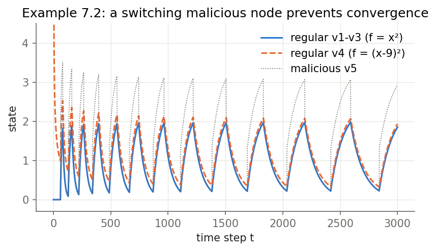
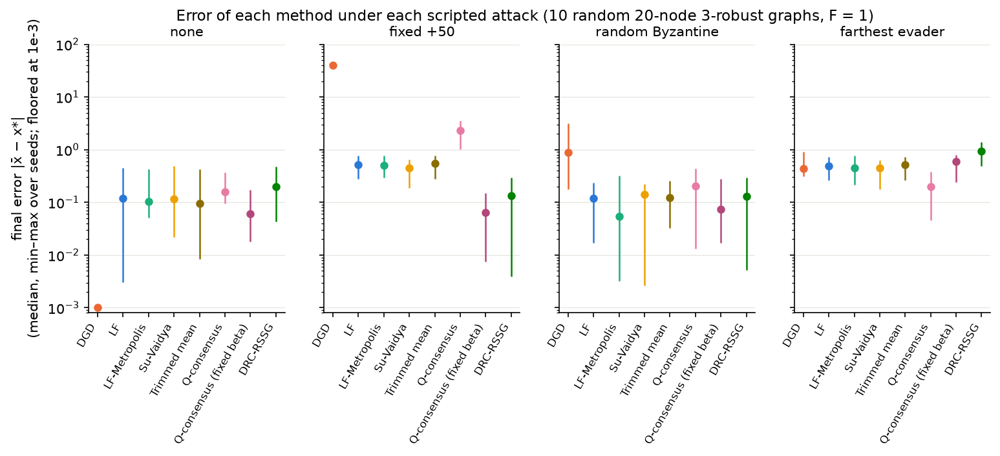
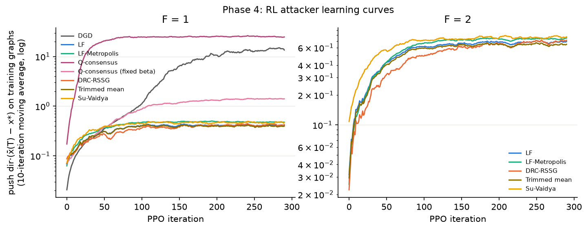
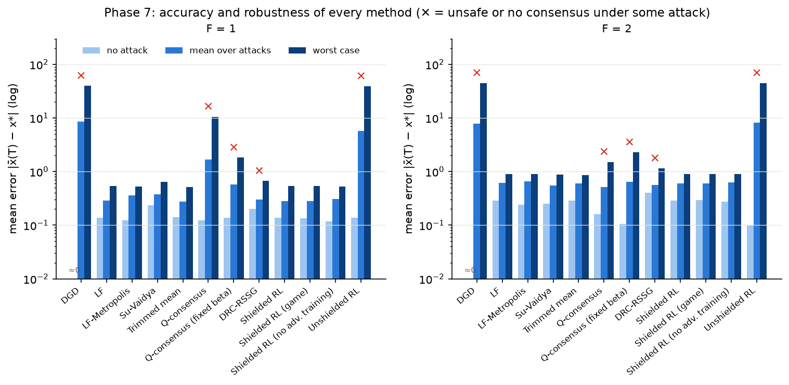
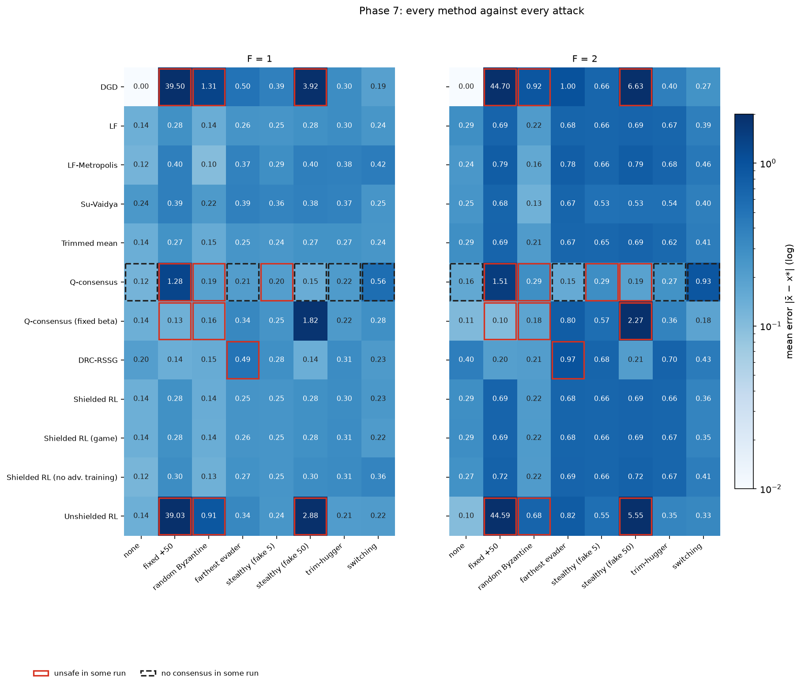
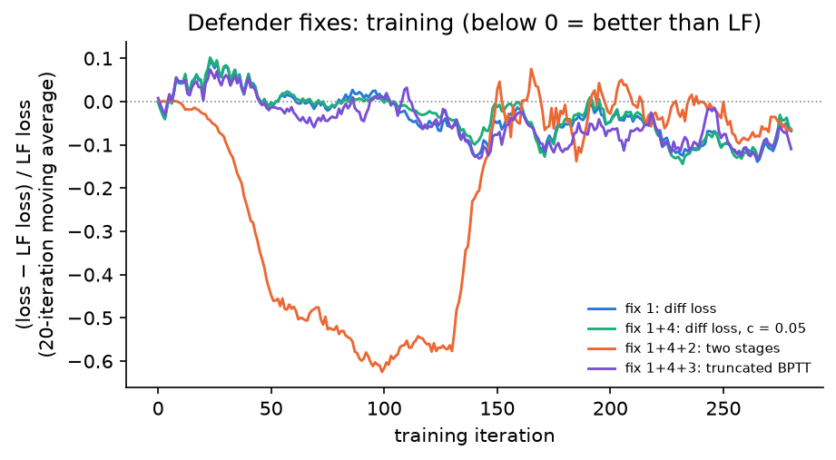

# Implementation Log

This file follows the [research proposal](README.md) as it turns into code and results. After every work session we record what we built, how we checked it, what we learned, and what comes next. Each phase builds on the one before, so the sections are best read in order.

## Status

| Phase | What | Status |
|---|---|---|
| 0 | Literature check | Web sweep done (2026-11-03, "Before the paper: checks"); a full Scholar / IEEE Xplore sweep is still open |
| 1 | Simulator + reproduction of [1] | **Done** (2026-10-28) |
| 2 | Baselines (DGD, LF, LF-Metropolis, Su–Vaidya, Q-consensus, DRC-RSSG) | **Done** (2026-10-28) |
| 3 | Scripted attack benchmark | **Done** (2026-10-30) |
| 4 | RL attacker | **Done** (2026-10-30) |
| 5 | Shielded defender + proof | **Done** (2026-10-30) |
| 6 | Zero-sum training | **Done** (2026-10-30); rerun with the memory + fallback defender (2026-11-03) |
| 7 | Evaluation | **Done** (2026-10-30); redone on 100 unseen graphs (2026-11-03) |
| 8 | Paper | Not started |

## The story so far

We first rebuilt the setting of Sundaram and Gharesifard [1] and checked that our simulator reproduces every claim we tested (Phase 1). We then added the methods we want to compare against (Phase 2) and attacked all of them with hand-written attacks (Phase 3). Only the trimming methods (LF, LF-Metropolis and Su–Vaidya) stayed safe, and the hand-written attacks seemed to hit a ceiling against them.

A learned attacker broke through that ceiling. It does 1.3–1.9 times more damage than the best hand-written attack, yet it still cannot push LF out of its safe region (Phase 4). Next we built a learned defender inside a "shield" and proved that it keeps all of LF's guarantees, whatever the network learns. Every experiment agrees with the proof: the shielded defender was never unsafe, while the same defender without the shield was easily captured (Phases 5–7).

The weak point is accuracy. The shielded defender only ties LF, and training it against attackers in a game did not change that (Phase 6). The safety and attack results are therefore solid, but making the defender learn something better than LF is still open. After Phase 7 we tried several training fixes. The shield turned out to leave plenty of room. A defender that gives each node a memory of its neighbours, with an option to fall back to LF, now beats LF on every attack on 100 unseen graphs, by about 6% on average, while staying inside the shield. Its gain also holds against an RL attacker trained specifically against it, and against attacks designed to fool its memory. Training it further in the attacker–defender game lowers its worst case again. In the final evaluation on 100 unseen graphs, these two learned defenders have the lowest mean and worst-case error of all safe methods (by 6% and 7–12% compared with LF). One trade-off remains: the defender cannot yet be the best against both steady pushes and switching attacks.

## Repository layout

```
advagent/
  graphs.py       example graphs of [1], random r-robust graphs, robustness checks,
                  maximum F-local set (integer program), F-local adversary sampling
  functions.py    local objectives: capped quadratics and |x - a|; x* and minimizer hull
  dynamics.py     LF filter, DGD and LF aggregation rules, step-size schedules, simulate()
  attacks.py      scripted adversaries: Fixed, UniformRandom (malicious/Byzantine),
                  FarthestEvader (Byzantine), Switching (Ex. 7.2), Stealthy (Thm. 4.4),
                  TrimHugger (Byzantine), StallSwitcher (switching on any graph)
  baselines.py    comparison methods: LF-Metropolis, Su-Vaidya [5], Q-consensus [7],
                  DRC-RSSG [10] (closed form + LP check)
  torchsim.py     batched, differentiable PyTorch simulator (padded neighbour lists):
                  all baselines and scripted attacks, Band action for RL attackers
  learn.py        training instances, PPO attacker (AttackerPolicy, train_attacker),
                  shielded defender (ShieldedDefender, train_defender)
  bench.py        shared Phase 3 benchmark in the batched simulator (evaluate, flag)
docs/
  shield_theorem.md   statement and proof that the shielded defender keeps [1]'s guarantees
experiments/
  phase1_reproduce.py   regenerates results/phase1/
  phase2_baselines.py   regenerates results/phase2/ (~25 s on 24 cores)
  phase3_attacks.py     regenerates results/phase3/ (~90 s on 24 cores)
  phase4_attacker.py    trains the RL attackers -> results/phase4/
  phase5_defender.py    trains the defenders (GPU) -> results/phase5/
  phase6_game.py        attacker/defender game rounds -> results/phase6/
  phase7_eval.py        final evaluation -> results/phase7/
tests/
  test_phase1.py  15 regression tests, one per claim of [1] we reproduce
  test_phase2.py  7 tests for the comparison methods
  test_phase3.py  6 tests for the new attacks
  test_phase4.py  PyTorch simulator = NumPy simulator (7 rules x 4 attacks x F = 1, 2), Band action
  test_phase5.py  shield: valid LF weights, wild random policies stay safe, unshielded is captured
results/phase1/   figures + summary.json
results/phase2/   table.md, raw.json, errors.png
results/phase3/   table.md, raw.json, heatmap.png, switching.png
results/phase4/   table.md, results.json, curves.png, attackers/*.pt
results/phase5/   table.md, results.json, heatmap.png, training.png, defenders/*.pt
results/phase6/   table.md, results.json, exploitability.png, defenders/, attackers/
results/phase7/   table.md, results.json, heatmap.png, robustness.png, attackers/*.pt
```

## How to run

Everything runs in the `advagent` conda environment, which provides Python 3.12, NumPy, SciPy, Matplotlib, NetworkX, pytest, PyTorch with CUDA and Gymnasium:

```bash
conda env create -f environment.yml
conda activate advagent

# tests (the env var stops ROS's globally installed pytest plugins from loading)
PYTEST_DISABLE_PLUGIN_AUTOLOAD=1 python -m pytest -q

# Phase 1-3 figures and numbers
PYTHONPATH=. python experiments/phase1_reproduce.py
PYTHONPATH=. python experiments/phase2_baselines.py
PYTHONPATH=. python experiments/phase3_attacks.py

# Phase 4-7 (learning; run in order, since each uses the policies saved by the one before)
PYTHONPATH=. python experiments/phase4_attacker.py      # CPU, parallel, ~1-2 h
PYTHONPATH=. python experiments/phase5_defender.py      # GPU, ~1 h
PYTHONPATH=. python experiments/phase6_game.py          # CPU + GPU, ~3 h for 3 rounds
PYTHONPATH=. python experiments/phase7_eval.py          # CPU, ~1.5 h (trains 8 attackers first)
```

On our 20-node graphs the tensors are tiny, so simulator rollouts actually run faster on the CPU than on the GPU. We therefore train the attackers in parallel CPU processes. Defender training is different: it backpropagates through all 2000 steps, which is where the GPU pays off (RTX 4060, about 1.5 GB per run).

## Simulator conventions

- `adj[i, j] = True` means there is an edge v_j → v_i, so node i receives node j's value.
- In each step, every regular node i first forms a consensus point y_i from its own value and the values it received. It then moves to x_i ← y_i − α_t · d_i, where d_i is a subgradient of f_i at y_i. This is exactly eq. (8) of [1].
- An adversary returns either one value for everyone (malicious) or one value per receiver, as an n × |A| matrix (Byzantine).
- **LF** drops up to F values strictly above and F strictly below the node's own value, and then averages uniformly over itself and what is left, so each weight is 1/(|J_i|+1) ≥ η.
- **DGD** uses Metropolis weights 1/(1 + max(d_i, d_j)), which are doubly stochastic on undirected graphs.
- **Step sizes:** `power_steps(c, p)` gives α_t = c/(t+1)^p. We use c = 0.5 and p = 0.6 by default, which satisfies Σα = ∞ and Σα² < ∞.

## Phase 1: reproducing [1]

Before trusting the simulator with anything new, we checked that it reproduces the paper. All 15 tests pass, and the table below compares each claim in [1] with what we measured (numbers from `results/phase1/summary.json`).

| Claim in [1] | Our result |
|---|---|
| Fig. 1 graph is 2-robust and (2,2)-robust, not 3-robust | Confirmed by brute force |
| Fig. 3 (U–W) graph is 3-robust; U is a maximum 1-local set | Confirmed (integer program, K = 2, 3, 5) |
| Maximum F-local set of a complete graph has size F | Confirmed for K5, K8 with F = 1, 2 |
| Prop. 4.3: one fixed adversary captures DGD | DGD mean reaches 42.9 of the adversary's 50 by t = 3000; LF stays at −0.15, inside the hull [−0.73, 0.58] |
| Ex. 6.2: LF-filtered graph not rooted, yet consensus under any single adversary | Kept edges match Fig. 1(b); filtered graph not rooted; spread < 1e−9 for all 5 adversary positions × 4 attacks, including Byzantine |
| Ex. 7.2: switching malicious node prevents convergence | 25 phase switches in 3000 steps; late mean keeps swinging between 0.25 and 2.00; no hull violation after t = 10 |
| Ex. 8.2 / Prop. 8.1: LF error equals b/4 on the U–W graph | Error 0.990 for b = 4 (b/4 = 1), identical for K = 2, 5, 10, 20; DGD error 1.5e−8 |
| Thms. 6.1 and 7.1: consensus + hull for F-local Byzantine on (2F+1)-robust graphs | Confirmed on 10 random 14-node graphs, F = 1, 2, random Byzantine noise in [−100, 100] |

| | |
|---|---|
|  |  |
|  | |

## Phase 2: the methods we compare against

> **Note (2026-11-03).** Until 2026-11-03, the method called "Su–Vaidya" here was a simpler trimmed mean, not the algorithm of [5] (see "Su–Vaidya check" below). The numbers in this and the later sections came from that rule, so they are now labelled "Trimmed mean". The real algorithm of [5] was added on 2026-11-03. Its results are in "Su–Vaidya check" and in the Phase 7 table on 100 unseen graphs. The rerun benchmark tables in `results/phase2`, `phase3`, `phase4` and `phase7` include both rules.

With a trusted simulator, we added the methods a new defender has to beat. Two of them, Q-consensus [7] and DRC-RSSG [10], were designed for pure consensus, so we gave them the same gradient step as every other method. We also added LF-Metropolis, a simple variant of our own that keeps LF's filter but changes the weights. It answers an obvious question: does a fixed, smarter weighting already fix LF's bias?

| Method | Source | Implementation notes |
|---|---|---|
| DGD | [3], [4] | Metropolis weights; no defence |
| LF | [1] | Uniform weights over self + retained set |
| LF-Metropolis | ours | LF filter, then Metropolis weights on the retained set. Stays inside the shield |
| Trimmed mean | (our stand-in for [5] until 2026-11-03) | Pools own value with received ones, drops the F largest and F smallest, averages; gradient at x_i(t).|
| Su–Vaidya | [5, Alg. 1] | Drops the F largest and F smallest *received* states and averages the rest with its own; nodes also exchange gradients, trim them and step along the midpoint; projection onto [−50, 50]. Added 2026-11-03 (see "Su–Vaidya check"). |
| Q-consensus | [7], Alg. 2 | Credibility Q_ij ← Q_ij + η(e^(−β_k\|x_j−x_i\|/scale) − Q_ij), with β_k = 10 + 0.1k and η = 0.01 as in [7]; `scale` = 10 for our state range. Also a fixed-β variant (β = 10) as a sensitivity check |
| DRC-RSSG | [10], Alg. 1 | Optimal Stackelberg weights in closed form, checked against an LP to 4e−16 on 300 random instances. Gets the true attack intensity each step, as [10] assumes. μ = 0.05 |

We ran all of them on 10 random 20-node 3-robust graphs with F = 1, random 1-local adversary sets of up to 3 nodes, and T = 2000 (full table: [results/phase2/table.md](results/phase2/table.md)).

| Method | No attack: error | Fixed +50: error | Random Byzantine: error | Evader: error | Ever unsafe? |
|---|---|---|---|---|---|
| DGD | **0.000** | 40.6 | 1.24 | 0.52 | Yes: captured by fixed attack (hull violation 39.8) |
| LF | 0.171 | 0.538 | 0.123 | 0.511 | No |
| LF-Metropolis | 0.166 | 0.527 | **0.096** | **0.472** | No |
| Trimmed mean | 0.161 | 0.545 | 0.127 | 0.521 | No |
| Q-consensus | 0.193 | 2.19 | 0.231 | 0.183 | Yes: no consensus at all (spread 5.2 with no attack); hull violation 13.4 under fixed attack |
| Q-consensus, fixed β | **0.080** | **0.072** | 0.123 | 0.552 | Yes: hull violation 4.4 under fixed attack; captured in pure consensus (excess 47) |
| DRC-RSSG | 0.226 | 0.140 | 0.132 | 0.935 | Yes: leaves the initial range under the evader (excess 1.78) |



### What we learned

1. **Only the trimming methods are safe in every scenario.** LF, LF-Metropolis and Trimmed mean never leave the safe region, while every learned or game-based method fails at least one safety check. This is the evidence behind gap G2.
2. **DRC-RSSG's safety claim is false, and a small example shows it** (`test_drc_rssg_safety_counterexample`). Take K5, which is 3-robust, so the graph conditions of both [1] and [10] hold, with F = 1 and regular values (10, 9.9, 9.9, 0). One Byzantine node sends 19 to the top node. DRC-RSSG drops the value farthest from the node's own, which is the honest 0 (distance 10) rather than the 19 (distance 9). After one step the top node sits at 12.8, outside the interval [0, 10] that [10, Problem 1, Thm. 1] claims never changes, while LF and Trimmed mean stay at 9.93. This confirms the doubt about Prop. 1 case (ii) raised in the proposal. It also hints at how a good attacker should behave: be extreme, but never the most extreme.
3. **Q-consensus falls apart once agents want different things.** Its trust score, e^(−β_k·distance), shrinks a little more every step because β_k keeps growing. Eventually every neighbour looks untrustworthy, the nodes stop listening to each other, and they never agree. With a fixed β it is accurate but can be captured. In its own pure-consensus setting it works (`test_q_consensus_reaches_consensus_in_its_own_setting`), so this is a property of the method rather than a bug in our code.
4. **Fixed reweighting is not enough.** On one graph in Phase 1, Metropolis weights helped LF a lot, but averaged over 10 graphs the gain is small (0.166 vs 0.171 with no attack, 0.096 vs 0.123 under random Byzantine). A fixed rule cannot follow the filter's kept set as it changes, and following it is exactly the job we want a learned policy to do. So the bar for RQ3 is "beat LF-Metropolis", not just "beat LF".
5. **The choice of attack decides the ranking.** DRC-RSSG looks like the most accurate method under the fixed attack and the least accurate under the evader. Evaluations with a single attack, as in [7] and [10], can therefore be misleading, which is one more reason to train against a learned attacker later.

## Phase 3: hand-written attacks

Phase 2 used only simple attacks. Before training an attacker, we wanted to know how far careful hand design can go, so we wrote three new attacks that target the filter directly.

| Attack | Type | What it does |
|---|---|---|
| Stealthy (fake 5 / fake 50) | Malicious | [1, Thm. 4.4]. Runs the defenders' own update rule exactly, but descends a fake objective (x − fake)². No method can tell it from an honest node; `test_stealthy_is_indistinguishable_from_a_regular_node` checks the trajectories match an honest run to 1e−12. Fake 5 is a plausible minimizer; fake 50 is not. |
| Trim-hugger | Byzantine | Sends each receiver a value just inside the F-th most extreme regular neighbour value on one side, so trimming rules always keep it (`test_trim_hugger_values_are_kept_by_lf`). |
| Switching (random graphs) | Byzantine | Alternates trim-hugging up and down, and switches whenever the regular mean stalls (moves < 3e−3 in 50 steps). Unlike the Ex. 7.2 attack, it needs no knowledge of the graph. |

We ran every method against all eight attacks for F = 1 and F = 2. For each F there are 10 random 20-node (2F+1)-robust graphs with up to 3F F-local adversaries, and T = 2000. In the tables, ⚠ (unsafe) means some run left the regular minimizer hull (t ≥ T/2) or the initial range (α = 0) by more than 1e−3, and ∅ (no consensus) means some run ended with a spread above 1. The full tables, including spread and oscillation, are in [results/phase3/table.md](results/phase3/table.md).

Mean error, F = 1:

| Method | none | fixed +50 | random Byz. | evader | stealthy 5 | stealthy 50 | trim-hugger | switching |
|---|---|---|---|---|---|---|---|---|
| DGD | 0.000 | 39.5 ⚠ | 1.23 ⚠ | 0.500 | 0.387 | 3.92 ⚠ | 0.300 | 0.194 |
| LF | 0.137 | 0.277 | 0.147 | 0.257 | 0.250 | 0.277 | 0.303 | 0.245 |
| LF-Metropolis | 0.123 | 0.397 | 0.097 | 0.370 | 0.289 | 0.397 | 0.384 | 0.421 |
| Trimmed mean | 0.141 | 0.269 | 0.154 | 0.251 | 0.241 | 0.269 | 0.266 | 0.242 |
| Q-consensus | 0.123 ∅ | 1.28 ⚠ | 0.226 ⚠ | 0.205 ∅ | 0.204 ⚠ | 0.145 ∅ | 0.221 ∅ | 0.557 ∅ |
| Q-consensus, fixed β | 0.138 | 0.134 ⚠ | 0.203 ⚠ | 0.337 | 0.255 | 1.82 | 0.225 | 0.282 |
| DRC-RSSG | 0.202 | 0.140 | 0.150 | 0.491 ⚠ | 0.280 | 0.140 | 0.310 | 0.225 |

Mean error, F = 2:

| Method | none | fixed +50 | random Byz. | evader | stealthy 5 | stealthy 50 | trim-hugger | switching |
|---|---|---|---|---|---|---|---|---|
| DGD | 0.000 | 44.7 ⚠ | 1.41 ⚠ | 1.00 | 0.655 | 6.63 ⚠ | 0.398 | 0.266 |
| LF | 0.291 | 0.692 | 0.213 | 0.679 | 0.658 | 0.692 | 0.666 | 0.390 |
| LF-Metropolis | 0.242 | 0.794 | 0.162 | 0.777 | 0.656 | 0.794 | 0.682 | 0.459 |
| Trimmed mean | 0.288 | 0.685 | 0.211 | 0.667 | 0.651 | 0.685 | 0.618 | 0.412 |
| Q-consensus | 0.162 ∅ | 1.51 ⚠ | 0.194 ⚠ | 0.152 ∅ | 0.292 ⚠ | 0.185 ⚠ | 0.265 ∅ | 0.929 ∅ |
| Q-consensus, fixed β | 0.106 | 0.102 ⚠ | 0.189 ⚠ | 0.797 | 0.565 | 2.27 ⚠ | 0.365 | 0.181 |
| DRC-RSSG | 0.402 | 0.200 | 0.210 | 0.974 ⚠ | 0.640 | 0.200 | 0.701 | 0.432 |

Under switching, the regular mean keeps moving: its total variation over t ≥ T/2 is 1.79 for LF with F = 1 and 2.81 with F = 2, compared with about 0.001 with no attack. Every method oscillates, even DGD (1.43 and 1.86).

We also ran the special graphs of [1]:

| Method | Ex. 7.2 (K5, switching): oscillation TV, t ≥ 1500 | Ex. 7.2: attacker switches | U–W (Ex. 8.2, no adversaries): error, bound b/4 = 1 |
|---|---|---|---|
| DGD | 0.002 | 0 | 0.000 |
| LF | 13.9 | 25 | 0.990 |
| LF-Metropolis | 17.0 | 28 | 0.947 |
| Trimmed mean | 16.8 | 34 | 0.993 |
| Q-consensus | 3.96 | 2 | 0.910 |
| Q-consensus, fixed β | 0.045 | 0 | 0.696 |
| DRC-RSSG | 12.4 | 24 | 0.993 |


### What we learned

1. **The trimming methods survive everything we wrote.** LF, LF-Metropolis and Trimmed mean stayed safe under all 8 attacks for both F = 1 and F = 2, with 0 unsafe runs out of 480. Thm. 7.1 holds even against attacks built to sit right at the filter's edge.
2. **The stealthy attack hurts everyone, even the method with no defence.** A plausible fake minimizer (fake 5) costs DGD 0.39 (F = 1) and 0.66 (F = 2), about as much as it costs LF. Nobody can filter this damage away. Against LF, stealthy fake 50 gives exactly the same error as fixed +50, because LF trims an extreme value no matter what story comes with it.
3. **Clever hand-written attacks are barely stronger than a simple one.** Against LF, trim-hugger reaches 0.303 against 0.277 for fixed +50 at F = 1, and at F = 2 it is even slightly weaker (0.666 vs 0.692). Hand design seems to hit a ceiling, and Phase 4 asks whether that ceiling is real or just a limit of our ideas.
4. **Switching causes oscillation rather than a fixed error.** On random graphs the mean keeps swinging across about 1.4 units and never settles (figure above). The final error then depends on when you stop, so we report oscillation (TV) next to error, as the proposal planned. On the Ex. 7.2 graph the attack breaks LF-Metropolis, Trimmed mean and DRC-RSSG as well as LF.
5. **LF-Metropolis is worse than LF under most attacks.** Under fixed +50 it reaches 0.40 against 0.28 (F = 1) and 0.79 against 0.69 (F = 2). It only wins with no attack or random noise, and its final spread is about twice LF's (0.31 vs 0.16), so its nodes agree more slowly. A fixed reweighting helps in some cases and hurts in others, which is another argument for weights that adapt to the attack.
6. **The |T|/n lower bound is tight on the U–W graph.** LF, LF-Metropolis, Trimmed mean and DRC-RSSG all end within about 5% of b/4, and only the unsafe Q-consensus variants get below it. On that graph no safe method, including ours, can do much better, so any room for a learned defender has to come from graphs where the safe methods sit well above the bound.
7. **Going from F = 1 to F = 2 roughly doubles or triples the error** of every safe method (LF: 0.28 → 0.69 under fixed +50).

## Phase 4: a learned attacker

Phase 3 left an open question: is the attack ceiling real? To find out, we trained an attacker with reinforcement learning.

### How it works

- **Simulator.** RL needs thousands of episodes, so we rewrote the simulator in PyTorch, batched over episodes (`advagent/torchsim.py`). `tests/test_phase4.py` checks that it matches the NumPy simulator for 7 rules × 4 attacks × F = 1, 2, with states, error and oscillation agreeing to 1e−6.
- **Action.** For each receiver, the attacker picks one number a, measured in the receiver's own "band". At a = 0 it sends the receiver's own value. At a = ±1 it sends the F-th most extreme regular neighbour value on that side, which is exactly what trim-hugger does. Beyond ±1 the value moves further out in steps of the neighbour spread, and everything is clipped to ±50. Because the action is relative to each receiver, the same policy makes sense on any graph and at any scale.
- **Policy.** One small network is shared by every (adversary, receiver) pair. It sees 14 local features (own value, neighbour values, the band edges and its previous action) and 5 global ones, and it acts every k = 10 steps.
- **Training.** We use PPO (γ = 1, λ = 0.95, clip 0.2) for 300 iterations of 48 episodes each, on random training graphs that are separate from the benchmark graphs. There are two objectives. The *bias* attacker pushes the regular mean in one direction; at test time it uses whichever direction hurts more on each instance. The *oscillation* attacker is rewarded for |Δ mean| at each decision from T/4 on, with k = 50.

We then tested it on the same instances as Phase 3 (full table: [results/phase4/table.md](results/phase4/table.md)).

### Results: the bias attacker

| Method | F | Best scripted attack (Phase 3) | RL attacker | RL / scripted | Safety broken? |
|---|---|---|---|---|---|
| LF | 1 | 0.303 | **0.539** | 1.78× | No |
| LF-Metropolis | 1 | 0.421 | **0.529** | 1.26× | No |
| Trimmed mean | 1 | 0.269 | **0.517** | 1.92× | No |
| DRC-RSSG | 1 | 0.491 | **0.666** | 1.35× | No |
| Q-consensus | 1 | 1.28 | **10.6** | 8.2× | Yes: hull violation 44 |
| Q-consensus, fixed β | 1 | 1.82 | 1.36 | 0.75× | (excess 0.07) |
| DGD | 1 | 39.5 | 22.7 | 0.57× | Yes (as with scripted) |
| LF | 2 | 0.692 | **0.898** | 1.30× | No |
| LF-Metropolis | 2 | 0.794 | **0.897** | 1.13× | No |
| Trimmed mean | 2 | 0.685 | **0.852** | 1.24× | No |
| DRC-RSSG | 2 | 0.974 | **1.144** | 1.17× | No |

The oscillation attacker was less convincing. Against LF on the Ex. 7.2 graph it reached a total variation of 20.2, compared with 11.3 for scripted switching, but only when it acted randomly. Its deterministic policy reached just 0.11. On random graphs it reached 0.76, below scripted switching (1.79).



### What we learned

1. **The ceiling from Phase 3 was a limit of our ideas, not a real limit.** Against the safe trimming methods the learned attacker does 1.3–1.9 times more damage than the best hand-written attack at F = 1, and 1.1–1.3 times more at F = 2. This answers RQ1: a learned attacker finds damage that hand design misses.
2. **Thm. 7.1 still holds against it.** Even though it was trained to do as much damage as possible, the attacker never pushed LF, LF-Metropolis or Trimmed mean out of the hull or the initial range.
3. **Methods without a guarantee break far more.** Against Q-consensus the error grows from 1.28 to 10.6, with a hull violation of 44. When there is a hole, the learned attacker finds it.
4. **The learned attacker is not the strongest everywhere.** Against DGD and fixed-β Q-consensus, the plain fixed +50 and stealthy attacks do more damage, because the band action keeps values close to the regular range by design. A fair evaluation should therefore report the worst of scripted and learned attacks, which is what Phase 7 does.
5. **Oscillation is harder to learn than bias.** The learned oscillation attacker only beats scripted switching through randomness, not by learning when to switch, so the scripted switching attack stays the reference for oscillation.

## Phase 5: a shielded learned defender

Phase 2 showed that a fixed reweighting cannot follow the filter, and Phase 4 gave us a strong attacker to train against. Phase 5 builds the core of the proposal: a defender that learns its weights but can never become unsafe.

### How it works

- **The shield.** The defender first runs LF's filter. A small DeepSets network then gives a score to the node itself and to every value LF kept, and the scores become weights through a *floored softmax*, which gives every weight at least η_i = c/(deg_i + 1), with c = 0.25. In [docs/shield_theorem.md](docs/shield_theorem.md) we prove that this is always a special case of LF's update (8) in [1]. Thms. 6.1, 6.4 and 7.1 therefore hold for **every** setting of the network's parameters, including while it is still training. `tests/test_phase5.py` backs this up by running random policies with huge parameters against the strongest attacks.
- **The policy.** It sees 15 features per value: own value, kept value, degrees, gradient, step size, and what the filter dropped. Its last layer starts at zero, so training starts from exactly LF.
- **Training.** We backpropagate through the whole simulation (T = 2000, with gradient checkpointing on the GPU) for 300 iterations, mixing F = 1 and F = 2. The loss is the final error divided by plain LF's error on the same episode, so a value below 1 means "better than LF". The training attacks are no attack, fixed ±50, random, evader, trim-hugger, switching, stealthy, and the Phase 4 attackers trained against LF.
- **Three variants.** Besides the shielded defender, we trained one without adversaries, to see what adversarial training adds. We also trained one with no filter and no floor, to see what the shield adds.

All three were tested on the Phase 3 instances (full table: [results/phase5/table.md](results/phase5/table.md)).

| Method | F = 1: no attack | F = 1: mean over attacks | F = 1: RL attacker | F = 2: mean over attacks | F = 2: RL attacker | Unsafe? |
|---|---|---|---|---|---|---|
| LF | 0.137 | 0.286 | 0.539 | 0.611 | 0.898 | No |
| LF-Metropolis | 0.123 | 0.361 | 0.529 | 0.651 | 0.884 | No |
| Trimmed mean | 0.141 | 0.275 | 0.516 | 0.598 | 0.849 | No |
| **Shielded RL** | 0.137 | 0.284 | 0.540 | 0.605 | 0.897 | **No** |
| Shielded RL (no adv. training) | 0.118 | 0.306 | 0.524 | 0.622 | 0.905 | No |
| Unshielded RL | 0.137 | 5.56 | 0.554 | 6.74 | 0.837 | **Yes**: error 39 / 45 under fixed +50 |

On the U–W graph, where the bound is b/4 = 1, the shielded defender ends at 0.990 like LF, while the unshielded one reaches 0.718.


### What we learned

1. **The shield works exactly as the proof says.** Neither shielded defender had a single unsafe run, under any attack, at either F.
2. **Without the shield, the learned defender gets captured.** The unshielded policy does well against the attacks it learned to handle (trim-hugger: 0.21 vs 0.30 for LF), but a plain fixed +50 attack drives its error to 39. Learning alone is not safe, which is the practical side of the shield theorem.
3. **The accuracy gain is tiny.** The shielded defender stays within about 1% of LF (0.284 vs 0.286 at F = 1, 0.605 vs 0.611 at F = 2) and is only slightly better under switching (0.234 vs 0.245). Training without adversaries improves the no-attack error (0.118 vs 0.137) but makes the error under attack worse. So RQ3, "beat LF and LF-Metropolis", is not answered yet.
4. **The likely reason is a weak training signal.** The relative loss never went clearly below 1. It became noisier instead, with a last-20 mean of 1.69, driven by episodes where LF's own error is tiny, so the policy learned to stay close to LF. Three causes seem likely: the ratio loss has heavy tails, the floor c = 0.25 leaves little freedom on nodes with few neighbours, and gradients through 2000 steps are poor.
5. **The |T|/n bound still holds on U–W**, as it must: no safe rule can beat it, and the shielded defender is a safe rule.

## Phase 6: attacker vs defender game

Phase 5 trained the defender against attackers that were built to beat LF, not to beat the defender itself. The natural next step is to let the two adapt to each other. We used alternating best responses with a growing pool of attackers, a simple form of PSRO.

The game starts from the Phase 5 shielded defender, D_0. In each round r, we train a PPO attacker against the current defender D_r for F = 1 and F = 2, warm-started and run for 150 iterations. Its damage on the benchmark is the defender's *exploitability*. We then fine-tune the defender for 150 iterations against the Phase 5 attack mix plus every attacker so far, which gives D_{r+1} (full table: [results/phase6/table.md](results/phase6/table.md)).

| Round | Exploitability, F = 1 | Exploitability, F = 2 | Max hull violation | Max excess (α = 0) |
|---|---|---|---|---|
| 0 | 0.539 | 0.898 | 0 | 0 |
| 1 | 0.535 | 0.903 | 0 | 0 |
| 2 | 0.539 | 0.904 | 0 | 0 |
| 3 | 0.537 | 0.899 | 0 | 0 |
| plain LF (Phase 4 attacker) | 0.539 | 0.898 | 0 | 0 |


### What we learned

1. **Safety held throughout the game.** No round produced a hull violation or a range excess, just as the shield theorem predicts.
2. **The game did not make the defender harder to attack.** Exploitability stayed at plain LF's level in every round. The defender's updates hardly moved it away from LF (relative loss ≈ 1 in every round), so each new attacker was effectively facing LF again.
3. **The bottleneck is the defender's learning, not the game.** The attacker side learns well, as Phase 4 showed. Until the defender can learn something better than LF on its own, more game rounds have nothing to improve.

## Phase 7: final evaluation

Finally, we put every method through the same test. Each faced all eight Phase 3 attacks plus a **best-response RL attacker**, a PPO attacker trained against that specific method. For the baselines this is the Phase 4 attacker. For the four learned defenders we trained a new one here, 200 iterations warm-started from the LF attacker. We used the same benchmark instances as before (10 random 20-node graphs per F, T = 2000), with mean and worst case taken over all attacks except "none". The full grids and the F = 2 summary are in [results/phase7/table.md](results/phase7/table.md).

Summary, F = 1 (mean error):

| Method | No attack | Mean over attacks | Worst case | Safe under every attack? |
|---|---|---|---|---|
| DGD | 0.000 | 8.59 | 39.5 (fixed +50) | No |
| LF | 0.137 | 0.286 | 0.539 (RL) | Yes |
| LF-Metropolis | 0.123 | 0.361 | 0.529 (RL) | Yes |
| Trimmed mean | 0.141 | **0.275** | **0.517** (RL) | Yes |
| Q-consensus | 0.123 | 1.95 | 12.8 (RL) | No |
| Q-consensus, fixed β | 0.138 | 0.572 | 1.82 (stealthy 50) | No |
| DRC-RSSG | 0.202 | 0.300 | 0.666 (RL) | No (evader) |
| Shielded RL | 0.137 | 0.284 | 0.540 (RL) | Yes |
| Shielded RL (game) | 0.136 | 0.283 | 0.538 (RL) | Yes |
| Shielded RL (no adv. training) | **0.118** | 0.307 | 0.528 (RL) | Yes |
| Unshielded RL | 0.137 | 5.73 | 39.0 (fixed +50) | No |

F = 2 tells the same story. Among the safe methods, LF reaches 0.611 / 0.898 (mean / worst), Trimmed mean 0.598 / 0.852 and the game-trained shielded defender 0.607 / 0.900, while the unshielded defender reaches 8.15 / 44.6. On the U–W graph every safe method ends at 0.95–0.99, right at the b/4 = 1 bound.





### What we learned

1. **Only the trimming methods and the shielded defenders are safe everywhere.** All four non-trimming baselines and the unshielded defender fail at least one safety check. This is the clearest result of the project. The shield turns any learned policy into one that is safe both in theory and in practice (the theorem half of C3), while the uncertified defences [7] and [10] fail the stress test (C2).
2. **Against every safe method, the strongest attack is the learned one.** The best-response RL attacker does 1.3–1.9 times more damage than the best hand-written attack at F = 1, and 1.1–1.3 times more at F = 2. Benchmarks that only use hand-written attacks underestimate the risk (C1).
3. **Learning has not improved accuracy yet.** The shielded defenders tie LF within 1%, Trimmed mean is still slightly better, and the game-trained defender is no better than the Phase 5 one. The only gain is the no-attack error of the defender trained without adversaries (0.118 vs 0.137), and it loses that gain under attack.
4. **The unshielded defender shows why the shield is needed.** It is accurate against attacks inside the trimming band (trim-hugger: 0.21 vs 0.30 for LF). However, a constant +50 attack captures it (error 39), and its own best-response attacker reaches 2.0 at F = 1 and 12.3 at F = 2.
5. **What this means for the paper.** C1, C2 and the theorem half of C3 are supported. The learned-aggregator half of C3 (lower error) and C4 are not. We either need a better-trained defender (Next steps, item 1) or a different framing, in which the shield is a safe envelope that lets future learned rules be deployed without risk.

## After Phase 7: trying to make the defender learn

Phase 7 left one big gap: the shielded defender only ties LF. We tried the fixes listed in the old Next steps, one at a time. The code is in `experiments/defender_room.py` and `experiments/defender_fixes.py`, and the results are in `results/defender_fixes/`. `learn.train_defender` gained two options: `loss_type="diff"` and `window` (truncated backpropagation with gradient checkpointing). Its defaults are unchanged.

### Fix 0: is there room to win?

First we asked whether the shield itself leaves room to beat LF. An "oracle" gets a free score for every node and neighbour slot on each benchmark graph. It knows x* and optimizes those scores directly, while staying inside the shield, so the scores still follow (2) of the theorem. Against every attack we tried (none, fixed +50, trim-hugger and the Phase 4 RL attacker), at F = 1 and 2, with c = 0.25 or 0.05, the oracle drove the error from LF's 0.14–0.74 down to at most 0.0006, and it never left the safe region.

**The shield is therefore not what holds the defender back.** Some weights inside the shield are almost perfect, but finding them needs knowledge that a local policy does not have: x* and the layout of the whole graph. The test is very loose. On each graph the error moves smoothly as the weights change, so the oracle can always tune them to hit x*. It shows that the shield allows a near-perfect result, not how much a local policy can reach.

### Fixes 1–4: training changes

Each variant was trained for 300 iterations on the Phase 5 training mix and tested on the Phase 7 benchmark instances. The variants are:

- **fix 1**, a steadier loss: (batch error − LF's batch error) / LF's batch error, instead of the mean of per-episode ratios;
- **fix 4**, a smaller floor, c = 0.05;
- **fix 2**, two stages: 150 iterations without attacks, then 150 with the full mix;
- **fix 3**, a loss every 200 steps instead of only at T = 2000.

| Method | F = 1 no attack | F = 1 mean / worst | F = 2 no attack | F = 2 mean / worst |
|---|---|---|---|---|
| LF | 0.137 | 0.286 / 0.539 | 0.291 | 0.611 / 0.898 |
| Trimmed mean | 0.141 | 0.275 / 0.516 | 0.288 | 0.598 / 0.849 |
| Shielded RL (Phase 5) | 0.137 | 0.284 / 0.540 | 0.291 | 0.605 / 0.897 |
| fix 1 | 0.112 | 0.317 / 0.515 | 0.281 | 0.625 / 0.874 |
| fix 1 + 4 | 0.114 | 0.311 / 0.524 | 0.275 | 0.625 / 0.877 |
| fix 1 + 4 + 2 | **0.101** | 0.316 / **0.494** | **0.259** | 0.645 / 0.880 |
| fix 1 + 4 + 3 | 0.110 | 0.328 / 0.506 | 0.271 | 0.641 / 0.857 |

Every variant was safe in every run.



### What we learned

1. **The defender now learns something, but it is a trade, not a win.** Every fix lowers the no-attack error (by up to 26% at F = 1) and the error under the strongest (RL) attack. However, it raises the error under the simple attacks. The worst case is "switching": 0.44 against LF's 0.25 at F = 1. As a result, the mean over attacks is 9–15% worse than LF at F = 1 and 2–5% worse at F = 2.
2. **Training and test disagree.** On the training graphs all variants end 8–10% below LF's loss, but on the benchmark graphs they are above it. The policy is fitting the training pool rather than learning a rule that transfers.
3. **The no-attack gain is large and real.** In stage 1 of the two-stage run the loss fell to 60% below LF. This is the centrality bias of Finding 2 being removed. Most of that gain was lost once attacks were added.
4. **A smaller floor (fix 4) and truncated backpropagation (fix 3) barely matter.** This agrees with fix 0: freedom inside the shield was never the limit.

### Literature-guided defenders: memory, fallback and constraints

A quick check changed how we read the results above. On 48 unseen graphs, the fix-1 defender behaves just as it does on its training graphs, so it is not overfitting. Its loss on the benchmark came from noise: with only 10 graphs, the switching attack alone moves the result by about 50%. From here on we therefore also test on **100 unseen graphs per F** (seeds disjoint from training and from the benchmark).

We then tried three ideas from the literature (code in `experiments/defender_trust.py`, results in `results/defender_trust/`):

- **memory + fallback.** `learn.TrustDefender` gives each node a running memory for every neighbour: how far that neighbour has been from it compared with the others, how often LF trimmed it, and on which side it was. This follows trust-based consensus (Yemini, Nedić, Goldsmith and Gil). A learned gate also blends the weights with LF's uniform ones, after the "fallback" designs of learning-augmented algorithms. Both stay inside the shield. The proof allows scores that depend on history, and a convex combination of two valid weight vectors is still valid, with every weight at or above the floor and the weights summing to 1.
- **constrained.** `loss_type="constrained"` adds a penalty λ_a · max(0, loss − LF loss) for each attack a. λ_a grows by dual ascent while the defender is worse than LF on that attack. This turns "no worse than LF on any attack" into a soft constraint, like SURF's descent constraints.
- **memory + fallback + constrained.** Both of the above.

All three use c = 0.05, the diff loss and 300 iterations.

**100 unseen graphs per F** (mean error over the 9 attacks; *wins* = attacks out of 9, counting "none", on which the method beats LF):

| Method | F = 1 no attack | F = 1 mean (vs LF) | F = 1 wins | F = 2 no attack | F = 2 mean (vs LF) | F = 2 wins |
|---|---|---|---|---|---|---|
| LF | 0.215 | 0.403 | – | 0.277 | 0.599 | – |
| Trimmed mean | 0.231 | 0.399 (−0.8%) | 3/9 | 0.289 | 0.586 (−2.1%) | 7/9 |
| fix 1 + 4 (above) | 0.184 | 0.385 (−4.4%) | 9/9 | 0.224 | 0.575 (−4.1%) | 7/9 |
| **memory + fallback** | **0.182** | **0.377 (−6.3%)** | **9/9** | **0.217** | **0.565 (−5.8%)** | **9/9** |
| constrained | 0.185 | 0.389 (−3.4%) | 7/9 | 0.229 | 0.581 (−3.0%) | 6/9 |
| memory + fallback + constrained | 0.198 | 0.394 (−2.2%) | 9/9 | 0.251 | 0.590 (−1.5%) | 8/9 |

Every method was safe on every graph. On the 10 benchmark graphs, memory + fallback is level with LF at F = 1 (+0.5%) and 3.1% better at F = 2. It loses only on switching, which is the noisy case. The full per-attack tables are in `results/defender_trust/trust.md`.

### What we learned

1. **For the first time, a learned defender beats LF across the board.** On 100 unseen graphs, memory + fallback is better than LF on all 9 attack settings at both F = 1 and F = 2. Its mean error over attacks is 6.3% and 5.8% lower, and its no-attack error is 15% and 22% lower. Against LF the error difference per graph is −0.025 ± 0.017 at F = 1 and −0.035 ± 0.023 at F = 2 (± 2 standard errors), and the defender is better on 62 of the 100 graphs in each case.
2. **It also beats Trimmed mean on average** (−0.8% and −2.1% vs LF on the same graphs). It now improves on every attack where LF was weak, including the constant +50 attack that hurt the earlier fixes.
3. **Memory is what helps; the constraint does not.** The penalty made training more cautious and the result worse. Combining it with memory lost most of the gain.
4. **Caveat (tested below): these attacks were not chosen against this defender.** The RL attacker here was trained against LF. Before we claim a robust gain, the defender has to face its own best-response attacker, as in Phase 7. A defender with memory may also be open to new attacks that exploit the memory, for example behaving honestly for a long time and then striking.

### Against its own best-response attacker

We repeated the Phase 7 test for the memory + fallback defender (`experiments/defender_br.py`, results in `results/defender_br/`). We trained an RL attacker against it for 200 PPO iterations, warm-started from the Phase 4 LF attacker. For a fair budget, LF got the same 200 extra iterations, and Trimmed mean kept its Phase 4 attacker. We also added two hand-written attacks aimed at the memory:
- **sleeper:** behaves honestly, then trim-hugs from t = 500 or t = 1000;
- **flicker:** alternates honest and trim-hugging every 25 steps, which is a little longer than the memory's ~20-step horizon.

**100 unseen graphs per F** (mean is over 12 attacks; *worst* is the method's worst attack, which is an RL attacker in every row):

| Method | F = 1 no attack | F = 1 mean | F = 1 worst | F = 2 no attack | F = 2 mean | F = 2 worst |
|---|---|---|---|---|---|---|
| LF | 0.215 | 0.418 | 0.609 | 0.277 | 0.610 | 0.889 |
| Trimmed mean | 0.231 | 0.413 | 0.602 | 0.289 | 0.596 | 0.871 |
| **memory + fallback** | **0.182** | **0.389** | **0.583** | **0.216** | **0.565** | **0.828** |

All methods were safe in every run. The first GPU run crashed with a CUDA launch failure, a driver fault, part-way through training; the run reported here was done on the CPU.

### What we learned

1. **The gain survives the best-response attacker.** The defender's worst case, which is its own best-response attacker, is 4% lower than LF's at F = 1 and 7% lower at F = 2. It is also lower than Trimmed mean's. It has the lowest no-attack error, mean error and worst-case error of the three methods.
2. **The memory cannot be exploited by these attacks.** Sleeper attacks do less damage to the defender than to LF. Flicker is where the defender gains most, at 19–21% below LF: a neighbour that keeps changing its behaviour is exactly what the memory notices.
3. **The best-response attacker did not get stronger.** Over 200 iterations its training curve stayed flat, against LF and against the defender alike. The Phase 4 attacker therefore seems to be a local optimum for PPO, and our "best response" is only as strong as PPO can make it. A stronger test would train an attacker from scratch, use the oscillation objective, or add an attack that looks at the defender's memory.
4. **The remaining weak spot is switching.** On the 100 unseen graphs the defender beats LF on switching but not Trimmed mean (0.305 vs 0.294 at F = 1). On the 10 benchmark graphs it is worse than both on switching.

### A stronger attacker search

The best-response attacker above never improved on its warm start, so we searched harder (`experiments/defender_attack_search.py`, results in `results/defender_attack_search/`). Per F we trained three kinds of attacker:
- **from scratch:** a fresh policy with no warm start, trained for 400 iterations;
- **swing:** a fresh policy with the oscillation objective, using the Phase 4 settings, trained for 300 iterations;
- **memory-aware:** `learn.MemoryAwareAttacker`, which also sees what each receiver's memory says about the adversaries. It was warm-started from the Phase 4 attacker and trained for 300 iterations.

From scratch and swing were trained against LF as well, for a fair budget. Every method then faced every learned attacker: these, the earlier best responses and the Phase 4 attacker. Each was run in both push directions (swing also with sampled actions), and we kept the worst result per graph.

**Worst learned attacker, 100 unseen graphs per F** (mean error):

| Method | F = 1 | F = 2 | Swing: oscillation of x̄, F = 1 / F = 2 |
|---|---|---|---|
| LF | 0.609 | 0.889 | 5.05 / 1.12 |
| Trimmed mean | 0.602 | 0.866 | 4.78 / 1.03 |
| **memory + fallback** | **0.584** | **0.833** | **4.75 / 1.03** |

All methods were safe against every attacker.

### What we learned

1. **The attack ceiling is real, not a training failure.** The from-scratch attackers start at a bias of about 0.1 and climb to the same strength as the Phase 4 attacker (about 0.61 / 0.89 against LF, and 0.58 / 0.82 against the defender). Two independent searches end at the same level, so this is close to the most a band attacker can do.
2. **Seeing the memory does not help the attacker.** The memory-aware attacker stayed flat during training and ends within 0.005 of the plain one. Against these attackers, the memory gives nothing away.
3. **The defender is harder to make swing.** During training the swing attacker reached an oscillation of 2.1 against LF but only 0.6 against the defender (F = 1). In evaluation the defender has the lowest oscillation of the three methods.
4. **The defender's worst case stays the best of the three on unseen graphs:** 4% below LF at F = 1 and 6% below at F = 2, and 3% and 4% below Trimmed mean. On the 10 benchmark graphs, Trimmed mean's worst case is slightly lower (0.516 vs 0.522 at F = 1, 0.849 vs 0.859 at F = 2); the larger set is the more reliable one.

### Closing the switching gap

Trimmed mean was still slightly better than memory + fallback against the switching attack. We trained three variants of the defender, each like memory + fallback (c = 0.05, diff loss, 300 iterations), and compared them on the 100 unseen graphs (`experiments/defender_switching.py`, results in `results/defender_switching/`):
- **switching-heavy mix:** the same defender, with extra switching-style attacks in training: stall-switchers with windows of 25, 50 and 100 steps, and flickers with periods of 25 and 50;
- **two-timescale memory:** a second, slower memory (factor 0.995, about 200 steps) next to the usual one (0.95, about 20 steps);
- **both together.**

| Method | Switching, F = 1 | Switching, F = 2 | Mean over attacks, F = 1 | Mean over attacks, F = 2 | Wins vs Trimmed mean, F = 1 / F = 2 |
|---|---|---|---|---|---|
| LF | 0.334 | 0.517 | 0.400 | 0.585 | 7 / 2 of 12 |
| Trimmed mean | 0.294 | 0.457 | 0.395 | 0.571 | — |
| memory + fallback | 0.305 | 0.471 | **0.372** | 0.541 | **11 / 11** of 12 |
| switching-heavy mix | **0.278** | 0.458 | 0.432 | 0.574 | 5 / 4 |
| two-timescale memory | 0.371 | 0.458 | 0.383 | **0.538** | 11 / 9 |
| two-timescale + switching-heavy | 0.349 | **0.358** | 0.427 | 0.546 | 3 / 8 |

All variants were safe under every attack.

### What we learned

1. **The gap can be closed, but only at a price.** The switching-heavy mix beats Trimmed mean on switching at F = 1 and ties it at F = 2. However, it is 7–20% worse than memory + fallback on the steady-push attacks (fixed +50, farthest evader, stealthy), so its mean over attacks is worse than LF's.
2. **A longer memory alone does not help with switching** at F = 1 (0.371). Combined with the switching-heavy mix it helps a lot at F = 2 (0.358), but not at F = 1.
3. **No single defender is best at everything.** Against steady pushes, a defender should trust its current view; against switching, it should distrust neighbours that behaved differently before. With one fixed network these pull in opposite directions. Memory + fallback remains the best all-rounder.

## Folding the new defender into the main results

### Phase 6 game with the memory + fallback defender

We reran the zero-sum game (`python experiments/phase6_game.py --defender trust`; results in `results/phase6_trust/`), starting from memory + fallback, with 3 rounds of 150 attacker and 150 defender iterations, scored on the 100 unseen graphs.

The first attempt reused the Phase 5 game settings, including the "ratio" loss. After one round the defender was as easy to attack as LF (0.606 / 0.886). The diff loss is what made memory + fallback work, so the game now uses it for this defender. The failed run is kept in `results/phase6_trust/ratio_loss_run/`.

| Round r | Exploitability, F = 1 | Exploitability, F = 2 |
|---|---|---|
| 0 (memory + fallback) | 0.582 | 0.829 |
| 1 | 0.581 | 0.814 |
| 2 | 0.574 | 0.821 |
| 3 (final) | **0.575** | **0.794** |
| plain LF | 0.609 | 0.889 |

Exploitability is the mean error that the round's best-response attacker causes. Every round was safe. Unlike the Phase 6 game with the shielded defender, which stayed flat at LF's level, this game keeps lowering the worst case: by 1% at F = 1 and 4% at F = 2 over three rounds.

### Phase 7 on 100 unseen graphs

We reran the Phase 7 evaluation on the 100 unseen graphs per F (`python experiments/phase7_eval.py --unseen --switch-variant 'switching-heavy mix'`; results in `results/phase7_unseen/`: `table.md`, `results.json`, `heatmap.png` and `robustness.png`). It covers all 14 methods. Each learned defender faces its own best-response attacker; the three new defenders got new ones here. The safe methods:

| Method | No attack, F = 1 | Mean, F = 1 | Worst case, F = 1 | No attack, F = 2 | Mean, F = 2 | Worst case, F = 2 |
|---|---|---|---|---|---|---|
| LF | 0.215 | 0.403 | 0.609 | 0.277 | 0.599 | 0.889 |
| LF-Metropolis | **0.157** | 0.418 | 0.578 | 0.217 | 0.615 | 0.851 |
| Su–Vaidya [5] (rerun 2026-11-03) | 0.220 | 0.447 | 0.672 | 0.249 | 0.599 | 0.953 |
| Trimmed mean | 0.231 | 0.399 | 0.602 | 0.289 | 0.587 | 0.871 |
| Shielded RL | 0.216 | 0.401 | 0.608 | 0.277 | 0.596 | 0.887 |
| Shielded RL (game) | 0.216 | 0.403 | 0.608 | 0.277 | 0.599 | 0.888 |
| **memory + fallback** | 0.182 | **0.378** | 0.582 | 0.216 | 0.565 | 0.829 |
| **memory + fallback (game)** | 0.172 | 0.412 | **0.569** | **0.184** | **0.564** | **0.785** |
| memory + fallback (switching) | 0.181 | 0.435 | 0.599 | 0.192 | 0.602 | 0.814 |

In every case the worst attack is the method's own best-response RL attacker. DGD, both Q-consensus variants, DRC-RSSG and the unshielded defender were unsafe, as before. On the U–W graph, all shielded defenders stay at LF's 0.990, under the bound of 1.

### What we learned

1. **The learned defender now beats every baseline on the main measures.** Memory + fallback has the lowest mean error at F = 1, and its game version has the lowest worst case at both F and the lowest mean at F = 2. Both are safe under every attack. This closes the open half of claim C3 in the proposal: a learned aggregator inside the shield is more accurate than LF and Trimmed mean, without losing any guarantee.
2. **The game version trades steady pushes for adaptive attackers.** It is the hardest to exploit: its worst case is 7% below LF at F = 1 and 12% below at F = 2, and at F = 2 it is the best of all methods on switching (0.379, against Trimmed mean's 0.457). The price is 6–9% more error than LF against steady pushes (fixed +50, farthest evader, stealthy fake 50), which is why its mean at F = 1 (0.412) is above LF's. Which version to report depends on whether the paper stresses the worst case (game) or the average (memory + fallback).
3. **LF-Metropolis is still the most accurate method without attack at F = 1** (0.157), but it is worse under attack. The new defenders are second (0.172–0.182).
4. **The U–W bias is not fixed.** No shielded defender moves below LF's 0.990 on the U–W graph. The memory helps against attacks, but it does not correct the centrality bias of finding 2.

## Before the paper: checks

### Literature sweep (Phase 0)

Before writing, we checked whether anyone has already published what we claim. This was a web search (2026-11-03), not a full Google Scholar or IEEE Xplore sweep. Some papers were judged from their abstracts and should be read in full before the paper cites them.

| Line of work | Closest papers | How it differs from ours |
|---|---|---|
| Learned consensus weights | Q-consensus, Hou et al., AAAI 2021 [7] ([pdf](https://cdn.aaai.org/ojs/16945/16945-13-20439-1-2-20210518.pdf)) | No trimming filter and no safety proof. It is one of our baselines, and it is unsafe in Phases 2–7. |
| Trust-based resilient optimization | Yemini, Gil and co-authors ([Harvard thesis](https://dash.harvard.edu/entities/publication/25ca06bf-ce7e-4960-babb-f5bdb2c437af), [arXiv 2212.02459](https://arxiv.org/html/2212.02459)); RP3 ([arXiv 2407.06541](https://arxiv.org/html/2407.06541)) | Trust comes from *physical* side observations, such as wireless signals, not from the exchanged values. This is what lets them tolerate more than half of the agents being malicious. Our memory uses only the values, needs no extra sensing, and the weights are learned. |
| Learnable aggregation weights | Parsa et al., ICLR 2026 ([arXiv 2511.03529](https://arxiv.org/pdf/2511.03529)) | Federated, with a central server. The weights are learned jointly with the model, and robustness is shown through the objective. There is no network and no trimming filter. As far as the abstract shows, it has no guarantee that holds for every possible set of weights. |
| GNN trust scores on top of a robust aggregator | GRAB-FL, *Neural Comput. Appl.* 2026 ([link](https://link.springer.com/article/10.1007/s00521-026-12446-9)) | Federated, empirical. It is the closest in spirit to the shield idea (learned weights layered over a robust rule), but it has no proof and no distributed optimization over a network. |
| RL-trained robust aggregation | GAAvernor ([pdf](https://nesa.zju.edu.cn/download/Justinian's%20GAAvernor%20Robust%20Distributed%20Learning%20with%20Gradient%20Aggregation%20Agent.pdf)) | Server-side and centralized, using auxiliary server data. |
| Robust decentralized learning, hand-designed | ClippedGossip ([arXiv 2202.01545](https://arxiv.org/pdf/2202.01545)), IOS ([arXiv 2206.04568](https://arxiv.org/pdf/2206.04568)), UBAR, Byzantine-robust gossip ([arXiv 2410.10418](https://arxiv.org/pdf/2410.10418)) | Fixed rules, so they are possible extra baselines. ClippedGossip's "dissensus" attack is a hand-written attack that our learned attacker should be compared with. |
| W-MSR / LF in multi-agent RL | Resilient consensus-based MARL ([arXiv 2111.06776](https://arxiv.org/pdf/2111.06776)) | Uses trimming to protect RL training, the reverse of our direction (RL to improve trimming). |
| Learned attackers | (none found) | We found no paper that trains an RL attacker against trimming rules in distributed optimization. |

**Conclusion.** We found no prior work on our three main claims: (i) a learned aggregator *inside* the LF filter, with a proof that [1]'s guarantees hold for every policy; (ii) a trust memory built only from exchanged values and learned end to end; and (iii) an RL attacker, and an attacker–defender game, against trimming rules. The nearest papers (Parsa et al. 2026, GRAB-FL 2026, the trust-based line) should be cited and contrasted in the related-work section. ClippedGossip and IOS could be added as baselines. Still to do before submission: a Google Scholar / IEEE Xplore sweep of papers citing [1] and [7], and a full reading of Parsa et al. and GRAB-FL.

### Su–Vaidya check

We read Algorithm 1 of [5] (TAC 2021, [accepted version](https://parsa.epfl.ch/course-info/cs723/papers/byzantine.pdf)) and compared it with `baselines.SuVaidya` / `torchsim.SuVaidya`. Our version differs in two ways:

1. **State trimming.** [5] trims the b largest and b smallest of the *received* estimates, then averages the rest together with the node's own estimate, which is always kept: `Average(Trim(D_i^x[t]) ∪ {x_i[t−1]})`, over d_i − 2b + 1 values. Our version pools the node's own value with the received ones before trimming, so the node's own value can be trimmed away.
2. **Gradient.** In [5], nodes also *exchange gradients*. Each node trims the received gradients together with its own and steps along the midpoint `½(max + min)` of the rest, then projects onto a compact set X. Our version uses only the node's own gradient, with no projection.

[5] also assumes a stricter graph condition: every reduced graph has a non-empty source component, because a Byzantine node may send different values to different neighbours. Our "Su–Vaidya" is therefore a simpler trimmed-mean rule, not [5]'s algorithm. The fix:
- implement Algorithm 1, letting adversaries send fake gradients as well as fake states;
- keep the current rule under a new name ("trimmed mean, own value pooled");
- rerun every comparison that includes it: Phases 2–3, the Phase 4 attacker against it, and Phase 7 on the unseen graphs.

The learned defender and the LF attackers do not depend on Su–Vaidya and are unchanged.

**Results with the real algorithm (2026-11-03).** We implemented [5, Alg. 1] in both simulators (`baselines.SuVaidya`, `torchsim.SuVaidya`; the old rule is now `TrimmedMean`, "Trimmed mean"). The simulators give a rule that sets `exchanges_gradients` the neighbours' gradients, each evaluated at the sender's own state. Adversaries also send fake gradients. By default, an adversary that pushes receiver i up sends the smallest honest gradient in i's pool, and one that pushes down sends the largest, so the lie is never trimmed (`dynamics.gradient_lie`, `torchsim.gradient_lie`). The stealthy attack sends honest gradients of its fake objective. The NumPy and torch versions agree in the tests. We then reran Phases 2 and 3, the Phase 4 attacker against Su–Vaidya (the old attacker is kept for the trimmed mean), and Phase 7 on both the benchmark and the 100 unseen graphs.

Mean error on 100 unseen graphs per F:

| Method | No attack, F = 1 | Mean, F = 1 | Worst case, F = 1 | No attack, F = 2 | Mean, F = 2 | Worst case, F = 2 |
|---|---|---|---|---|---|---|
| LF | 0.215 | 0.403 | 0.609 | 0.277 | 0.599 | 0.889 |
| Su–Vaidya [5] | 0.220 | 0.447 | 0.672 | 0.249 | 0.599 | 0.953 |
| Trimmed mean (old stand-in) | 0.231 | 0.399 | 0.602 | 0.289 | 0.587 | 0.871 |
| memory + fallback | 0.182 | **0.378** | 0.582 | 0.216 | 0.565 | 0.829 |
| memory + fallback (game) | **0.172** | 0.412 | **0.569** | **0.184** | **0.564** | **0.785** |

### What we learned

1. **The real Su–Vaidya is safe, but weaker than LF under attack.** Its worst case is 10% above LF's at F = 1 and 7% above at F = 2. Exchanging gradients gives the adversaries a second channel: even a fake gradient that survives trimming moves the midpoint step. Without attack it is better than LF at F = 2 (0.249 vs 0.277), and on the benchmark its final spread is about half of LF's.
2. **It is strongest where the adversary's values look honest.** At F = 2 it beats memory + fallback on stealthy (fake 50) (0.597 vs 0.633) and switching (0.437 vs 0.471). Against steady pushes (fixed +50, farthest evader) it is the weakest safe method.
3. **Our conclusions get stronger.** Both memory + fallback defenders beat the real Su–Vaidya on mean and worst case at both F. The earlier "beats Su–Vaidya" statements were made against the trimmed mean, which is the stronger of the two rules under attack, so they still hold.
4. **Caveat.** The learned attackers control only the values they send; their fake gradients follow the fixed rule above. An attacker that also learned its gradients could only do more damage to Su–Vaidya, so its numbers here are a lower bound on how far it can be pushed.

## Findings and decisions

None of these were obvious from the paper, and each one changed how we did later phases.

1. **DGD needs doubly stochastic weights.** With uniform weights, DGD on the U–W graph converged to 0.64 instead of x* = 1, even without adversaries. Lemma 3.4 of [1] explains why: the nodes end up minimizing a sum weighted by how central each node is. After we switched DGD to Metropolis weights, it became exact.
2. **LF's uniform weights cause the same bias, and that is where a learned defender could help.** Because LF averages uniformly over what it keeps, it also minimizes a centrality-weighted objective instead of the true average. Learned weights inside the shield could correct this without leaving the region where [1]'s theorems hold. Fixed Metropolis reweighting recovers only a small part of it (Phase 2, point 4).
3. **The maximum F-local set must be a proper subset.** The whole node set V is trivially F-local, so we require at least one node outside the set. With that rule we reproduce the paper's "size F in complete graphs".
4. **The Ex. 7.2 attack needs hysteresis.** A naive "switch when things settle" rule flips every step once the nodes agree. The working attack watches the regular mean instead: it exposes itself when the mean falls below 0.25 and hides when it rises above 2.0. Both thresholds lie between the two equilibria of the oscillation, which we measured at 0 and 2.45.
5. **Harmonic step sizes kill the oscillation in practice.** With α_t = c/(t+1), each Ex. 7.2 cycle takes much longer than the one before, giving only 2–6 switches in 5000 steps. With α_t = 0.5/(t+1)^0.6 the oscillation stays visible. Since the attacker's success depends on the schedule, experiments should always report it.
6. **Hull violations at t = 1 are expected.** A large first step (α_0 ≈ 1) can overshoot the hull, and Thm. 7.1 is only about the long run, so our safety metrics skip a short burn-in of 10 steps.

## Next steps

1. **One defender for both steady pushes and switching.** No single trained network was best at both. Options: let the gate also use the slow memory, so the defender only distrusts a neighbour after a change in its behaviour; or train against the steady-push and switching attacks with the constrained loss, which keeps the defender no worse than LF on each attack.
2. **Fix the U–W bias.** No defender moves below LF's 0.990 on the U–W graph. Training on graphs like U–W, where uniform weights are biased, may teach the weights to correct for centrality (finding 2).
3. **A tighter measure of room.** The oracle of fix 0 is too strong to be useful. A fairer one would use one set of weights shared across graphs, or compare the safe methods with the |T|/n bound (this needs each graph's maximum F-local set).
4. **Optional extra baselines:** ClippedGossip and IOS (see the literature sweep).

## Changelog

- **2026-11-03 (3).** Real Su–Vaidya [5, Alg. 1] with gradient exchange and default gradient lies (`exchanges_gradients`, `gradient_lie`, `torchsim.descend`); old rule kept as "Trimmed mean". Phases 2–3, the Phase 4 Su–Vaidya attacker and Phase 7 (benchmark and unseen) rerun. On unseen graphs the real Su–Vaidya is safe but worse than LF under attack (worst 0.672 / 0.953 vs 0.609 / 0.889); the memory + fallback defenders beat it on mean and worst case. Older sections relabelled "Trimmed mean". Removed a stray `git push` from the first line of `experiments/defender_switching.py`.

- **2026-11-03 (2).** Shield theorem: added a remark that memory-dependent scores and the LF fallback gate stay inside the proposition; added a NaN guard on the gate and 10 tests for the memory + fallback defender (117 tests pass). Web literature sweep: no prior work found on our three main claims. Su–Vaidya check: our implementation is a simpler trimmed mean, not [5]'s Algorithm 1 (which trims received states only and exchanges trimmed gradients), so it must be replaced.

- **2026-11-03.** New defender folded into the main results. Switching variants (`experiments/defender_switching.py`): the gap to Su–Vaidya closes only at a cost on steady pushes, so memory + fallback stays the all-rounder. The Phase 6 game with memory + fallback (`--defender trust`, diff loss) lowers exploitability over 3 rounds to 0.575 / 0.794, against LF's 0.609 / 0.889. Phase 7 on 100 unseen graphs (`--unseen`, `results/phase7_unseen/`): memory + fallback has the lowest mean at F = 1, and its game version the lowest worst case at both F; all safe. The game and switching scripts now resume after a crash, and the switching evaluation and Phase 7 `--unseen` use fewer worker processes to stay within RAM.

- **2026-11-01.** Literature-guided defenders (`experiments/defender_trust.py`): `learn.TrustDefender` (per-neighbour memory + LF fallback gate) and `loss_type="constrained"`; evaluation on 100 unseen graphs per F. Memory + fallback beats LF on all 9 attack settings at F = 1 and 2 (mean −6.3% / −5.8%) and beats Su–Vaidya; all safe. Not yet tested against its own best-response attacker.
- **2026-11-02.** Stronger attacker search (`experiments/defender_attack_search.py`, `learn.MemoryAwareAttacker`): from-scratch, swing and memory-aware attackers. From-scratch attackers reach the same ceiling as the Phase 4 one; seeing the memory does not help; the defender keeps the lowest worst case on unseen graphs (0.584 / 0.833 vs LF 0.609 / 0.889). All safe.
- **2026-11-01 (2).** Best-response test (`experiments/defender_br.py`): with its own RL attacker plus sleeper and flicker attacks, the memory + fallback defender still has the lowest no-attack, mean and worst-case error (worst −4% / −7% vs LF); all safe. The attacker did not improve over its warm start, so a stronger attacker search is next.
- **2026-10-31 (2).** Defender fixes: oracle "room" check (`experiments/defender_room.py`) and four training variants (`experiments/defender_fixes.py`); `train_defender` gained `loss_type="diff"` and `window`. The shield leaves near-perfect weights available; the new defenders cut no-attack error by up to 26% but are 2–15% worse than LF on the mean over attacks. All safe.
- **2026-10-31.** Rewrote this log and the README in connected, plainer prose; no results changed.
- **2026-10-30 (3).** Phase 7 complete: 11 methods × 8 scripted attacks + a best-response RL attacker per method, F = 1, 2, and the U–W graph. Only the trimming methods and the shielded defenders are safe everywhere; the shielded defenders tie LF on accuracy; Su–Vaidya remains the most accurate safe method.
- **2026-10-30 (2).** Phases 4–6 complete. Batched PyTorch simulator (`torchsim.py`), checked against NumPy; PPO attacker with a band action (1.3–1.9× stronger than the best scripted attack on the safe methods, never breaks their safety); shielded defender with proof (`docs/shield_theorem.md`), safe in every run but only ~1% better than LF; unshielded ablation captured by a fixed attack; 3-round zero-sum game, exploitability flat at LF's level. Conda environment `advagent` (`environment.yml`).
- **2026-10-30.** Phase 3 complete: Stealthy, TrimHugger and StallSwitcher attacks; `Result.oscillation`; 8-attack × 7-method benchmark for F = 1 and 2, plus the Ex. 7.2 and U–W graphs; 6 new tests (28 total). Work moved to `main` (the `implementation` branch was merged and removed).
- **2026-10-28 (2).** Phase 2 complete: LF-Metropolis, Su–Vaidya, Q-consensus (two variants) and DRC-RSSG; farthest-evader attack; 10-seed benchmark; DRC-RSSG safety counterexample; 22 tests passing. Corrected Phase 1 finding 2.
- **2026-10-28.** Phase 1 complete: simulator, example graphs, robustness and F-local tools, DGD/LF, three scripted attacks, 15 passing tests, three reproduction figures.
