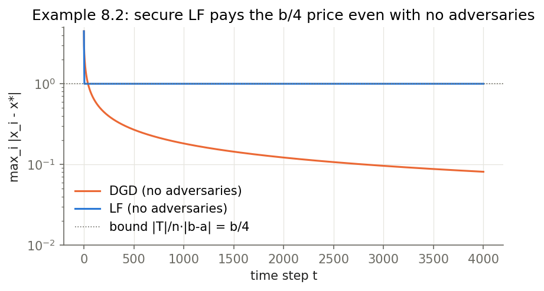

# Implementation Log

Progress on the implementation and validation of the [research proposal](README.md). This file is updated at the end of every work session: what was built, what was verified, what we learned, and what comes next.

## Status

| Phase | What | Status |
|---|---|---|
| 0 | Literature check | Partly done (see proposal §3); Scholar sweep still open |
| 1 | Simulator + reproduction of [1] | **Done** (2026-10-28) |
| 2 | Baselines (DGD, LF, LF-Metropolis, Su–Vaidya, Q-consensus, DRC-RSSG) | **Done** (2026-10-28) |
| 3 | Scripted attack benchmark | Fixed, random, switching, farthest-evader done; stealthy fake-cost and trim-hugging next |
| 4 | RL attacker | Not started |
| 5 | Shielded defender + proof | Not started |
| 6 | Zero-sum training | Not started |
| 7 | Evaluation | Not started |
| 8 | Paper | Not started |

## Repository layout

```
advagent/
  graphs.py       example graphs of [1], random r-robust graphs, robustness checks,
                  maximum F-local set (integer program), F-local adversary sampling
  functions.py    local objectives: capped quadratics and |x - a|; x* and minimizer hull
  dynamics.py     LF filter, DGD and LF aggregation rules, step-size schedules, simulate()
  attacks.py      scripted adversaries: Fixed, UniformRandom (malicious/Byzantine),
                  FarthestEvader (Byzantine), Switching (Ex. 7.2)
  baselines.py    comparison methods: LF-Metropolis, Su-Vaidya [5], Q-consensus [7],
                  DRC-RSSG [10] (closed form + LP check)
experiments/
  phase1_reproduce.py   regenerates results/phase1/
  phase2_baselines.py   regenerates results/phase2/ (~25 s on 24 cores)
tests/
  test_phase1.py  15 regression tests, one per claim of [1] we reproduce
  test_phase2.py  7 tests for the comparison methods
results/phase1/   figures + summary.json
results/phase2/   table.md, raw.json, errors.png
```

## How to run

```bash
# tests (the env var stops ROS's globally installed pytest plugins from loading)
PYTEST_DISABLE_PLUGIN_AUTOLOAD=1 python3 -m pytest -q

# Phase 1 figures and numbers
PYTHONPATH=. python3 experiments/phase1_reproduce.py
```

Requirements so far: Python 3.13, NumPy, SciPy, Matplotlib, NetworkX (tests only). PyTorch is not yet installed; it is needed from Phase 4.

## Simulator conventions

- `adj[i, j] = True` means edge (v_j → v_i): node i receives node j's value.
- One step for each regular node i: form the consensus point y_i from its own value and received values, then x_i ← y_i − α_t · d_i, with d_i a subgradient of f_i at y_i, exactly as in eq. (8) of [1].
- Adversaries return either one broadcast value each (malicious) or an n × |A| matrix of per-receiver values (Byzantine).
- **LF:** drops up to F values strictly above and F strictly below the node's own value, then averages uniformly over itself and the retained set (weight 1/(|J_i|+1) ≥ η).
- **DGD:** uses Metropolis weights 1/(1 + max(d_i, d_j)), which are doubly stochastic on undirected graphs.
- **Step sizes:** `power_steps(c, p)` gives α_t = c/(t+1)^p. Default c = 0.5, p = 0.6, which satisfies Σα = ∞ and Σα² < ∞.

## Phase 1 results: reproduction of [1]

All 15 tests pass. Numbers are from `results/phase1/summary.json`.

| Claim in [1] | Our result |
|---|---|
| Fig. 1 graph is 2-robust and (2,2)-robust, not 3-robust | Confirmed by brute force |
| Fig. 3 (U–W) graph is 3-robust; U is a maximum 1-local set | Confirmed (integer program, K = 2, 3, 5) |
| Maximum F-local set of a complete graph has size F | Confirmed for K5, K8 with F = 1, 2 |
| Prop. 4.3: one fixed adversary captures DGD | DGD mean reaches 42.9 of the adversary's 50 by t = 3000; LF stays at −0.15, inside the hull [−0.73, 0.58] |
| Ex. 6.2: LF-filtered graph not rooted, yet consensus under any single adversary | Kept edges match Fig. 1(b); filtered graph not rooted; spread < 1e−9 for all 5 adversary positions × 4 attacks, including Byzantine |
| Ex. 7.2: switching malicious node prevents convergence | 25 phase switches in 3000 steps; late mean keeps swinging between 0.25 and 2.00; no hull violation after t = 10 |
| Ex. 8.2 / Prop. 8.1: LF error equals b/4 on the U–W graph | Error 0.990 for b = 4 (b/4 = 1), identical for K = 2, 5, 10, 20; DGD error 1.5e−8 |
| Thms. 6.1 and 7.1: consensus + hull for F-local Byzantine on (2F+1)-robust graphs | Confirmed on 10 random 14-node graphs, F = 1, 2, random Byzantine noise in [−100, 100] |

Figures:

| | |
|---|---|
|  |  |
|  | |

## Phase 2 results: comparison methods

### How each method is implemented

| Method | Source | Implementation notes |
|---|---|---|
| DGD | [3], [4] | Metropolis weights; no defence |
| LF | [1] | Uniform weights over self + retained set |
| LF-Metropolis | ours | LF filter, then Metropolis weights on the retained set. Stays inside the shield. Tests whether simple reweighting fixes LF's bias |
| Su–Vaidya | [5] | Pools own value with received ones, drops the F largest and F smallest, averages; gradient at x_i(t). *Written from the published description; check against the paper's pseudocode before submission* |
| Q-consensus | [7], Alg. 2 | Credibility Q_ij ← Q_ij + η(e^(−β_k\|x_j−x_i\|/scale) − Q_ij), with β_k = 10 + 0.1k and η = 0.01 as in [7]; `scale` = 10 for our state range. Also a fixed-β variant (β = 10) as a sensitivity check |
| DRC-RSSG | [10], Alg. 1 | Optimal Stackelberg weights in closed form, checked against an LP to 4e−16 on 300 random instances. Gets the true attack intensity each step, as [10] assumes. μ = 0.05 |

Q-consensus and DRC-RSSG were designed for pure consensus. We add the same gradient step as for every other method.

### Benchmark

Setup: 10 random 20-node 3-robust graphs, F = 1, random 1-local adversary sets (up to 3 nodes), T = 2000. Full table: [results/phase2/table.md](results/phase2/table.md).

| Method | No attack: error | Fixed +50: error | Random Byzantine: error | Evader: error | Ever unsafe? |
|---|---|---|---|---|---|
| DGD | **0.000** | 40.6 | 1.24 | 0.52 | Yes: captured by fixed attack (hull violation 39.8) |
| LF | 0.171 | 0.538 | 0.123 | 0.511 | No |
| LF-Metropolis | 0.166 | 0.527 | **0.096** | **0.472** | No |
| Su–Vaidya | 0.161 | 0.545 | 0.127 | 0.521 | No |
| Q-consensus | 0.193 | 2.19 | 0.231 | 0.183 | Yes: no consensus at all (spread 5.2 with no attack); hull violation 13.4 under fixed attack |
| Q-consensus, fixed β | **0.080** | **0.072** | 0.123 | 0.552 | Yes: hull violation 4.4 under fixed attack; captured in pure consensus (excess 47) |
| DRC-RSSG | 0.226 | 0.140 | 0.132 | 0.935 | Yes: leaves the initial range under the evader (excess 1.78) |


### What Phase 2 tells us

1. **Only the trimming methods (LF, LF-Metropolis, Su–Vaidya) are safe in every scenario.** Every learned or game-based method fails at least one safety check. This is the empirical case for gap G2.
2. **DRC-RSSG's safety claim is false, with a hand-checkable counterexample** (`test_drc_rssg_safety_counterexample`). Setup: K5 (3-robust, so the graph conditions of both [1] and [10] hold), F = 1, regular values (10, 9.9, 9.9, 0), and one Byzantine node that sends 19 to the top node. DRC-RSSG drops the value farthest from the node's own, which is the regular 0 (distance 10), not the 19 (distance 9). One step takes the top node to 12.8, outside the interval [0, 10] that [10, Problem 1, Thm. 1] claims is invariant. LF and Su–Vaidya stay at 9.93. This confirms the concern about Prop. 1 case (ii) in the proposal. It is also the template for an RL attacker: be extreme, but never the most extreme.
3. **Q-consensus breaks down once agents have different objectives.** Its trust test (e^(−β_k·distance), with β_k growing every step) eventually rejects every neighbour, so the nodes stop listening to each other and never agree. With a fixed β it is accurate but can be captured. It does work in its own pure-consensus setting (`test_q_consensus_reaches_consensus_in_its_own_setting`), so this is a property of the method, not a bug.
4. **Correction to Phase 1 finding 2: Metropolis reweighting is not enough.** Averaged over 10 graphs, LF-Metropolis improves on LF only slightly (0.166 vs 0.171 with no attack; 0.096 vs 0.123 under random Byzantine). The large gain seen on one graph was not typical. A fixed reweighting rule cannot follow the filter's changing kept set, which is the job we want a learned policy to do. The bar for RQ3 is therefore "beat LF-Metropolis", not just "beat LF".
5. **Attack choice decides the ranking.** DRC-RSSG is the most accurate safe-looking method under the fixed attack and the least accurate under the evader. Single-attack evaluations, as in [7] and [10], are misleading. This supports training against a learned attacker (Phase 6).

## Findings and decisions

These were not obvious from the paper and affect later phases.

1. **DGD needs doubly stochastic weights.** With uniform weights, DGD on the U–W graph converged to 0.64 instead of x* = 1, even with no adversaries. Lemma 3.4 of [1] explains why: the nodes minimize a centrality-weighted sum. We switched DGD to Metropolis weights, after which it is exact.
2. **Uniform LF weights cause the same bias, and this is where a learned defender can help.** LF averages uniformly over the retained set, so it too targets a centrality-weighted objective, not the true average. Learned weights inside the shield (Formulation B) can correct this without leaving the set where [1]'s theorems hold. *Update after Phase 2:* fixed Metropolis reweighting recovers only a small part of this (Phase 2, point 4).
3. **The maximum F-local set must be a proper subset.** S = V is vacuously F-local. We require at least one node outside S, which reproduces the paper's "size F in complete graphs".
4. **The Ex. 7.2 attack needs hysteresis.** A naive "switch when settled" rule chatters every step once nodes agree. The working attack switches on the regular mean: expose below 0.25, shadow above 2.0. These thresholds sit inside the two phase equilibria, which we measured at 0 and 2.45. An RL attacker (Phase 4) should rediscover this on its own.
5. **Harmonic steps kill the oscillation in practice.** With α_t = c/(t+1), each Ex. 7.2 cycle takes much longer than the last (only 2–6 switches in 5000 steps). With α_t = 0.5/(t+1)^0.6 the oscillation stays visible. Experiments should report the step-size schedule, since the attacker's success depends on it.
6. **Hull violations at t = 1 are expected.** A large first step (α_0 ≈ 1) can overshoot the hull. Theorem 7.1 is asymptotic, so safety metrics use a short burn-in (10 steps).

## Next steps

1. **Phase 3.** Add the stealthy fake-cost attack (Thm. 4.4), the trim-boundary hugging attack, and Ex. 7.2-style switching on random graphs. Extend the benchmark to F = 2 and to the U–W and Ex. 7.2 graphs.
2. Check the Su–Vaidya implementation against the pseudocode in [5].
3. Vectorise `simulate()` across episodes before RL training. The current per-node Python loop is fine for validation (~0.4 s per 2000-step run on 20 nodes) but too slow for training.
4. Install PyTorch (+ Gymnasium/PettingZoo) for Phase 4.

## Changelog

- **2026-10-28 (2).** Phase 2 complete: LF-Metropolis, Su–Vaidya, Q-consensus (two variants) and DRC-RSSG; farthest-evader attack; 10-seed benchmark; DRC-RSSG safety counterexample; 22 tests passing. Corrected Phase 1 finding 2.
- **2026-10-28.** Phase 1 complete: simulator, example graphs, robustness and F-local tools, DGD/LF, three scripted attacks, 15 passing tests, three reproduction figures.
