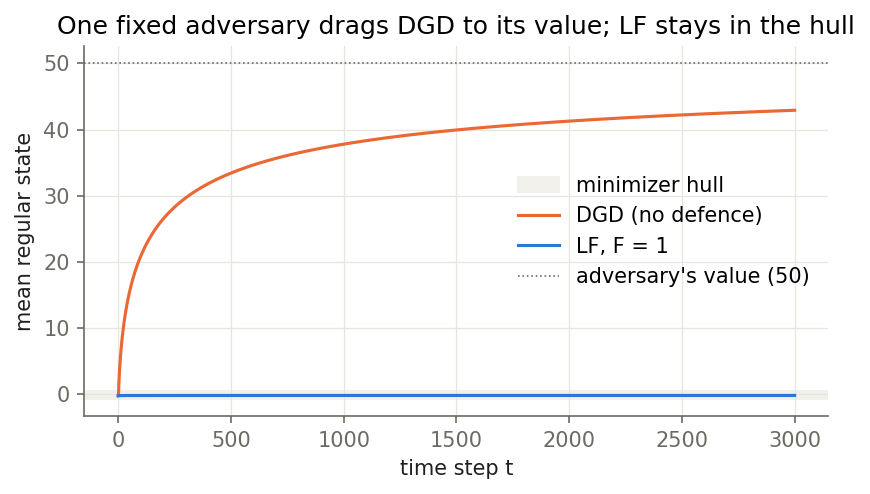
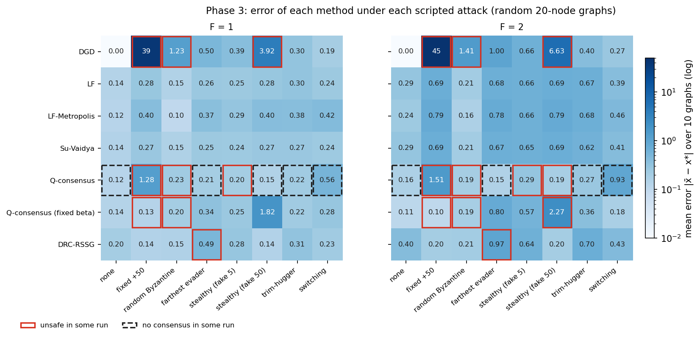
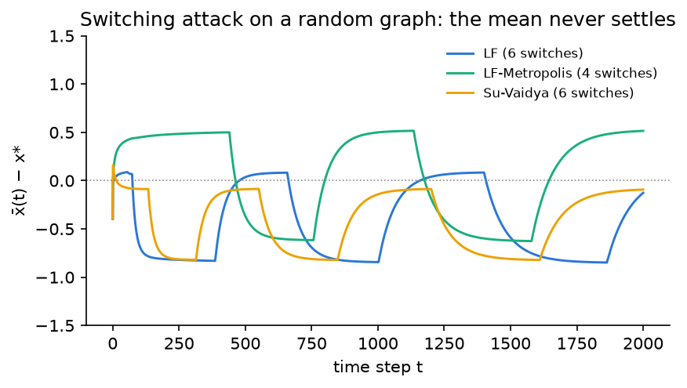
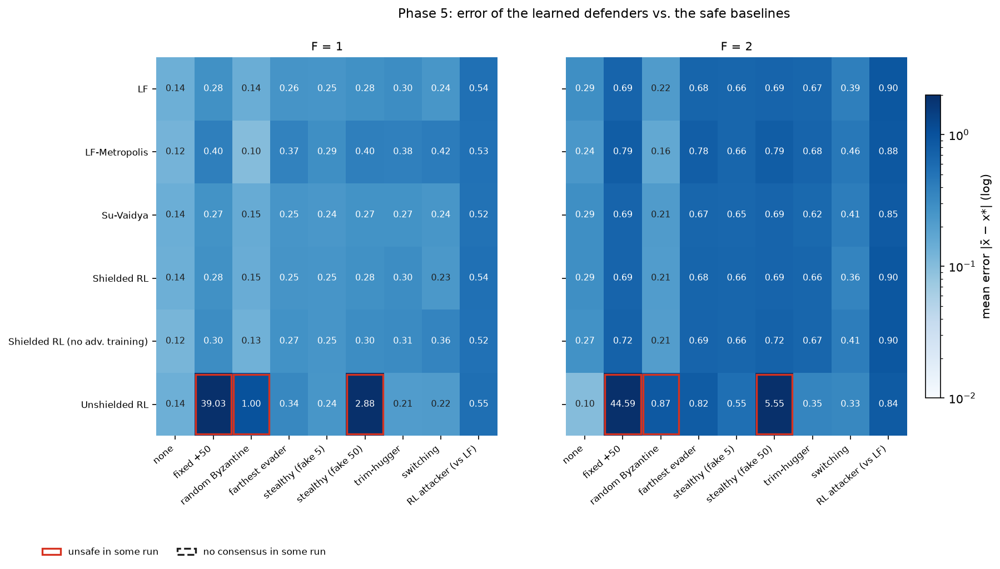
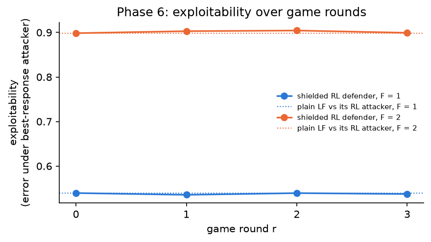

# Implementation Log

Progress on the implementation and validation of the [research proposal](README.md). This file is updated at the end of every work session: what was built, what was verified, what we learned, and what comes next.

## Status

| Phase | What | Status |
|---|---|---|
| 0 | Literature check | Partly done (see proposal §3); Scholar sweep still open |
| 1 | Simulator + reproduction of [1] | **Done** (2026-10-28) |
| 2 | Baselines (DGD, LF, LF-Metropolis, Su–Vaidya, Q-consensus, DRC-RSSG) | **Done** (2026-10-28) |
| 3 | Scripted attack benchmark | **Done** (2026-10-30) |
| 4 | RL attacker | **Done** (2026-10-30) |
| 5 | Shielded defender + proof | **Done** (2026-10-30) |
| 6 | Zero-sum training | **Done** (2026-10-30) |
| 7 | Evaluation | Running (script ready: `experiments/phase7_eval.py`) |
| 8 | Paper | Not started |

## Repository layout

```
advagent/
  graphs.py       example graphs of [1], random r-robust graphs, robustness checks,
                  maximum F-local set (integer program), F-local adversary sampling
  functions.py    local objectives: capped quadratics and |x - a|; x* and minimizer hull
  dynamics.py     LF filter, DGD and LF aggregation rules, step-size schedules, simulate()
  attacks.py      scripted adversaries: Fixed, UniformRandom (malicious/Byzantine),
                  FarthestEvader (Byzantine), Switching (Ex. 7.2), Stealthy (Thm. 4.4),
                  TrimHugger (Byzantine), StallSwitcher (switching on any graph)
  baselines.py    comparison methods: LF-Metropolis, Su-Vaidya [5], Q-consensus [7],
                  DRC-RSSG [10] (closed form + LP check)
  torchsim.py     batched, differentiable PyTorch simulator (padded neighbour lists):
                  all baselines and scripted attacks, Band action for RL attackers
  learn.py        training instances, PPO attacker (AttackerPolicy, train_attacker),
                  shielded defender (ShieldedDefender, train_defender)
  bench.py        shared Phase 3 benchmark in the batched simulator (evaluate, flag)
docs/
  shield_theorem.md   statement and proof that the shielded defender keeps [1]'s guarantees
experiments/
  phase1_reproduce.py   regenerates results/phase1/
  phase2_baselines.py   regenerates results/phase2/ (~25 s on 24 cores)
  phase3_attacks.py     regenerates results/phase3/ (~90 s on 24 cores)
  phase4_attacker.py    trains the RL attackers -> results/phase4/
  phase5_defender.py    trains the defenders (GPU) -> results/phase5/
  phase6_game.py        attacker/defender game rounds -> results/phase6/
  phase7_eval.py        final evaluation -> results/phase7/
tests/
  test_phase1.py  15 regression tests, one per claim of [1] we reproduce
  test_phase2.py  7 tests for the comparison methods
  test_phase3.py  6 tests for the new attacks
  test_phase4.py  PyTorch simulator = NumPy simulator (7 rules x 4 attacks x F = 1, 2), Band action
  test_phase5.py  shield: valid LF weights, wild random policies stay safe, unshielded is captured
results/phase1/   figures + summary.json
results/phase2/   table.md, raw.json, errors.png
results/phase3/   table.md, raw.json, heatmap.png, switching.png
results/phase4/   table.md, results.json, curves.png, attackers/*.pt
results/phase5/   table.md, results.json, heatmap.png, training.png, defenders/*.pt
results/phase6/   table.md, results.json, exploitability.png, defenders/, attackers/
```

## How to run

All experiments use the `advagent` conda environment (Python 3.12, NumPy, SciPy, Matplotlib, NetworkX, pytest, PyTorch with CUDA, Gymnasium):

```bash
conda env create -f environment.yml
conda activate advagent

# tests (the env var stops ROS's globally installed pytest plugins from loading)
PYTEST_DISABLE_PLUGIN_AUTOLOAD=1 python -m pytest -q

# Phase 1-3 figures and numbers
PYTHONPATH=. python experiments/phase1_reproduce.py
PYTHONPATH=. python experiments/phase2_baselines.py
PYTHONPATH=. python experiments/phase3_attacks.py

# Phase 4-7 (learning; in order, each uses the previous phase's saved policies)
PYTHONPATH=. python experiments/phase4_attacker.py      # CPU, parallel, ~1-2 h
PYTHONPATH=. python experiments/phase5_defender.py      # GPU, ~1 h
PYTHONPATH=. python experiments/phase6_game.py          # CPU + GPU, ~3 h for 3 rounds
PYTHONPATH=. python experiments/phase7_eval.py
```

Compute note: simulator rollouts on 20-node graphs are faster on the CPU than on the GPU (the tensors are tiny), so attackers train on CPU processes in parallel. Defender training backpropagates through 2000 steps and runs on the GPU (RTX 4060, ~1.5 GB per run).

## Simulator conventions

- `adj[i, j] = True` means edge (v_j → v_i): node i receives node j's value.
- One step for each regular node i: form the consensus point y_i from its own value and received values, then x_i ← y_i − α_t · d_i, with d_i a subgradient of f_i at y_i, exactly as in eq. (8) of [1].
- Adversaries return either one broadcast value each (malicious) or an n × |A| matrix of per-receiver values (Byzantine).
- **LF:** drops up to F values strictly above and F strictly below the node's own value, then averages uniformly over itself and the retained set (weight 1/(|J_i|+1) ≥ η).
- **DGD:** uses Metropolis weights 1/(1 + max(d_i, d_j)), which are doubly stochastic on undirected graphs.
- **Step sizes:** `power_steps(c, p)` gives α_t = c/(t+1)^p. Default c = 0.5, p = 0.6, which satisfies Σα = ∞ and Σα² < ∞.

## Phase 1 results: reproduction of [1]

All 15 tests pass. Numbers are from `results/phase1/summary.json`.

| Claim in [1] | Our result |
|---|---|
| Fig. 1 graph is 2-robust and (2,2)-robust, not 3-robust | Confirmed by brute force |
| Fig. 3 (U–W) graph is 3-robust; U is a maximum 1-local set | Confirmed (integer program, K = 2, 3, 5) |
| Maximum F-local set of a complete graph has size F | Confirmed for K5, K8 with F = 1, 2 |
| Prop. 4.3: one fixed adversary captures DGD | DGD mean reaches 42.9 of the adversary's 50 by t = 3000; LF stays at −0.15, inside the hull [−0.73, 0.58] |
| Ex. 6.2: LF-filtered graph not rooted, yet consensus under any single adversary | Kept edges match Fig. 1(b); filtered graph not rooted; spread < 1e−9 for all 5 adversary positions × 4 attacks, including Byzantine |
| Ex. 7.2: switching malicious node prevents convergence | 25 phase switches in 3000 steps; late mean keeps swinging between 0.25 and 2.00; no hull violation after t = 10 |
| Ex. 8.2 / Prop. 8.1: LF error equals b/4 on the U–W graph | Error 0.990 for b = 4 (b/4 = 1), identical for K = 2, 5, 10, 20; DGD error 1.5e−8 |
| Thms. 6.1 and 7.1: consensus + hull for F-local Byzantine on (2F+1)-robust graphs | Confirmed on 10 random 14-node graphs, F = 1, 2, random Byzantine noise in [−100, 100] |

Figures:

| | |
|---|---|
|  |  |
|  | |

## Phase 2 results: comparison methods

### How each method is implemented

| Method | Source | Implementation notes |
|---|---|---|
| DGD | [3], [4] | Metropolis weights; no defence |
| LF | [1] | Uniform weights over self + retained set |
| LF-Metropolis | ours | LF filter, then Metropolis weights on the retained set. Stays inside the shield. Tests whether simple reweighting fixes LF's bias |
| Su–Vaidya | [5] | Pools own value with received ones, drops the F largest and F smallest, averages; gradient at x_i(t). *Written from the published description; check against the paper's pseudocode before submission* |
| Q-consensus | [7], Alg. 2 | Credibility Q_ij ← Q_ij + η(e^(−β_k\|x_j−x_i\|/scale) − Q_ij), with β_k = 10 + 0.1k and η = 0.01 as in [7]; `scale` = 10 for our state range. Also a fixed-β variant (β = 10) as a sensitivity check |
| DRC-RSSG | [10], Alg. 1 | Optimal Stackelberg weights in closed form, checked against an LP to 4e−16 on 300 random instances. Gets the true attack intensity each step, as [10] assumes. μ = 0.05 |

Q-consensus and DRC-RSSG were designed for pure consensus. We add the same gradient step as for every other method.

### Benchmark

Setup: 10 random 20-node 3-robust graphs, F = 1, random 1-local adversary sets (up to 3 nodes), T = 2000. Full table: [results/phase2/table.md](results/phase2/table.md).

| Method | No attack: error | Fixed +50: error | Random Byzantine: error | Evader: error | Ever unsafe? |
|---|---|---|---|---|---|
| DGD | **0.000** | 40.6 | 1.24 | 0.52 | Yes: captured by fixed attack (hull violation 39.8) |
| LF | 0.171 | 0.538 | 0.123 | 0.511 | No |
| LF-Metropolis | 0.166 | 0.527 | **0.096** | **0.472** | No |
| Su–Vaidya | 0.161 | 0.545 | 0.127 | 0.521 | No |
| Q-consensus | 0.193 | 2.19 | 0.231 | 0.183 | Yes: no consensus at all (spread 5.2 with no attack); hull violation 13.4 under fixed attack |
| Q-consensus, fixed β | **0.080** | **0.072** | 0.123 | 0.552 | Yes: hull violation 4.4 under fixed attack; captured in pure consensus (excess 47) |
| DRC-RSSG | 0.226 | 0.140 | 0.132 | 0.935 | Yes: leaves the initial range under the evader (excess 1.78) |


### What Phase 2 tells us

1. **Only the trimming methods (LF, LF-Metropolis, Su–Vaidya) are safe in every scenario.** Every learned or game-based method fails at least one safety check. This is the empirical case for gap G2.
2. **DRC-RSSG's safety claim is false, with a hand-checkable counterexample** (`test_drc_rssg_safety_counterexample`). Setup: K5 (3-robust, so the graph conditions of both [1] and [10] hold), F = 1, regular values (10, 9.9, 9.9, 0), and one Byzantine node that sends 19 to the top node. DRC-RSSG drops the value farthest from the node's own, which is the regular 0 (distance 10), not the 19 (distance 9). One step takes the top node to 12.8, outside the interval [0, 10] that [10, Problem 1, Thm. 1] claims is invariant. LF and Su–Vaidya stay at 9.93. This confirms the concern about Prop. 1 case (ii) in the proposal. It is also the template for an RL attacker: be extreme, but never the most extreme.
3. **Q-consensus breaks down once agents have different objectives.** Its trust test (e^(−β_k·distance), with β_k growing every step) eventually rejects every neighbour, so the nodes stop listening to each other and never agree. With a fixed β it is accurate but can be captured. It does work in its own pure-consensus setting (`test_q_consensus_reaches_consensus_in_its_own_setting`), so this is a property of the method, not a bug.
4. **Correction to Phase 1 finding 2: Metropolis reweighting is not enough.** Averaged over 10 graphs, LF-Metropolis improves on LF only slightly (0.166 vs 0.171 with no attack; 0.096 vs 0.123 under random Byzantine). The large gain seen on one graph was not typical. A fixed reweighting rule cannot follow the filter's changing kept set, which is the job we want a learned policy to do. The bar for RQ3 is therefore "beat LF-Metropolis", not just "beat LF".
5. **Attack choice decides the ranking.** DRC-RSSG is the most accurate safe-looking method under the fixed attack and the least accurate under the evader. Single-attack evaluations, as in [7] and [10], are misleading. This supports training against a learned attacker (Phase 6).

## Phase 3 results: scripted attack benchmark

### The new attacks

| Attack | Type | What it does |
|---|---|---|
| Stealthy (fake 5 / fake 50) | Malicious | [1, Thm. 4.4]. Runs the defenders' own update rule exactly, but descends a fake objective (x − fake)². No method can tell it from an honest node; `test_stealthy_is_indistinguishable_from_a_regular_node` checks the trajectories match an honest run to 1e−12. Fake 5 is a perfectly plausible minimizer; fake 50 is not. |
| Trim-hugger | Byzantine | To each receiver, sends a value just inside the F-th most extreme regular neighbour value on one side. Trimming rules keep it every time (`test_trim_hugger_values_are_kept_by_lf`). |
| Switching (random graphs) | Byzantine | Alternates trim-hugging up and down, switching whenever the regular mean stalls (moves < 3e−3 in 50 steps). Needs no knowledge of the graph, unlike the Ex. 7.2 attack. |

### Benchmark

Setup: F = 1 and F = 2; for each, 10 random 20-node (2F+1)-robust graphs with up to 3F F-local adversaries; T = 2000. Unsafe (⚠) = some run left the regular minimizer hull (t ≥ T/2) or the initial range (α = 0) by more than 1e−3. No consensus (∅) = some run ended with spread above 1. Full tables, including spread and oscillation: [results/phase3/table.md](results/phase3/table.md).

Mean error, F = 1:

| Method | none | fixed +50 | random Byz. | evader | stealthy 5 | stealthy 50 | trim-hugger | switching |
|---|---|---|---|---|---|---|---|---|
| DGD | 0.000 | 39.5 ⚠ | 1.23 ⚠ | 0.500 | 0.387 | 3.92 ⚠ | 0.300 | 0.194 |
| LF | 0.137 | 0.277 | 0.147 | 0.257 | 0.250 | 0.277 | 0.303 | 0.245 |
| LF-Metropolis | 0.123 | 0.397 | 0.097 | 0.370 | 0.289 | 0.397 | 0.384 | 0.421 |
| Su–Vaidya | 0.141 | 0.269 | 0.154 | 0.251 | 0.241 | 0.269 | 0.266 | 0.242 |
| Q-consensus | 0.123 ∅ | 1.28 ⚠ | 0.226 ⚠ | 0.205 ∅ | 0.204 ⚠ | 0.145 ∅ | 0.221 ∅ | 0.557 ∅ |
| Q-consensus, fixed β | 0.138 | 0.134 ⚠ | 0.203 ⚠ | 0.337 | 0.255 | 1.82 | 0.225 | 0.282 |
| DRC-RSSG | 0.202 | 0.140 | 0.150 | 0.491 ⚠ | 0.280 | 0.140 | 0.310 | 0.225 |

Mean error, F = 2:

| Method | none | fixed +50 | random Byz. | evader | stealthy 5 | stealthy 50 | trim-hugger | switching |
|---|---|---|---|---|---|---|---|---|
| DGD | 0.000 | 44.7 ⚠ | 1.41 ⚠ | 1.00 | 0.655 | 6.63 ⚠ | 0.398 | 0.266 |
| LF | 0.291 | 0.692 | 0.213 | 0.679 | 0.658 | 0.692 | 0.666 | 0.390 |
| LF-Metropolis | 0.242 | 0.794 | 0.162 | 0.777 | 0.656 | 0.794 | 0.682 | 0.459 |
| Su–Vaidya | 0.288 | 0.685 | 0.211 | 0.667 | 0.651 | 0.685 | 0.618 | 0.412 |
| Q-consensus | 0.162 ∅ | 1.51 ⚠ | 0.194 ⚠ | 0.152 ∅ | 0.292 ⚠ | 0.185 ⚠ | 0.265 ∅ | 0.929 ∅ |
| Q-consensus, fixed β | 0.106 | 0.102 ⚠ | 0.189 ⚠ | 0.797 | 0.565 | 2.27 ⚠ | 0.365 | 0.181 |
| DRC-RSSG | 0.402 | 0.200 | 0.210 | 0.974 ⚠ | 0.640 | 0.200 | 0.701 | 0.432 |

Oscillation (total variation of the regular mean over t ≥ T/2) under switching: LF 1.79 (F = 1) and 2.81 (F = 2), against about 0.001 with no attack. Every method oscillates, including DGD (1.43, 1.86).

Special graphs of [1]:

| Method | Ex. 7.2 (K5, switching): oscillation TV, t ≥ 1500 | Ex. 7.2: attacker switches | U–W (Ex. 8.2, no adversaries): error, bound b/4 = 1 |
|---|---|---|---|
| DGD | 0.002 | 0 | 0.000 |
| LF | 13.9 | 25 | 0.990 |
| LF-Metropolis | 17.0 | 28 | 0.947 |
| Su–Vaidya | 16.8 | 34 | 0.993 |
| Q-consensus | 3.96 | 2 | 0.910 |
| Q-consensus, fixed β | 0.045 | 0 | 0.696 |
| DRC-RSSG | 12.4 | 24 | 0.993 |





### What Phase 3 tells us

1. **The three trimming methods stay safe under all 8 attacks, for F = 1 and F = 2** (0 unsafe runs out of 480). This is Thm. 7.1 holding against attacks designed to sit right at the filter's edge.
2. **The stealthy attack (Thm. 4.4) hurts every method, even the undefended one.** A plausible fake minimizer (fake 5) costs DGD 0.39 (F = 1) and 0.66 (F = 2), about as much as it costs LF. This damage cannot be filtered away by anyone. Against LF, stealthy fake 50 gives exactly the same error as fixed +50, because LF trims the extreme value whatever story it tells.
3. **Clever hand-written attacks are barely stronger than a simple one against LF.** Trim-hugger: 0.303 vs fixed +50: 0.277 (F = 1); 0.666 vs 0.692 (F = 2). Hand design seems to hit a ceiling. Phase 4's RL attacker will show whether that ceiling is real or just a limit of our designs.
4. **Switching damage is oscillation, not final error.** On random graphs the mean keeps swinging across about 1.4 units and never settles (figure above). The final error then depends on when you stop, so oscillation (TV) must be reported alongside error, as the proposal planned. On the Ex. 7.2 graph the attack also breaks LF-Metropolis, Su–Vaidya and DRC-RSSG, not just LF.
5. **LF-Metropolis is worse than LF under most attacks** (0.40 vs 0.28 under fixed +50, F = 1; 0.79 vs 0.69 for F = 2). It is better only with no attack or random noise. Its final spread is also about twice LF's (0.31 vs 0.16), so it agrees more slowly. A fixed reweighting rule helps in some scenarios and hurts in others. This strengthens the case for weights that adapt to the attack.
6. **The |T|/n lower bound is tight on the U–W graph.** LF, LF-Metropolis, Su–Vaidya and DRC-RSSG all end within about 5% of b/4. On that graph no safe method, including ours, can do much better. Only the unsafe Q-consensus variants get below it. The learned defender's room for improvement lies on graphs where the safe methods sit far above the bound.
7. **F = 2 roughly doubles to triples the error of every safe method** (LF: 0.28 → 0.69 under fixed +50).

## Phase 4 results: RL attacker

### Setup

- **Simulator.** `advagent/torchsim.py` re-implements the simulator in PyTorch, batched over episodes. `tests/test_phase4.py` checks it against the NumPy simulator for 7 rules × 4 attacks × F = 1, 2 (states, error and oscillation match to 1e−6).
- **Action ("band").** For each receiver, the adversary picks a number a. a = 0 sends the receiver's own value; a = ±1 sends the F-th most extreme regular neighbour value on that side (the trim-hugger edge); beyond ±1 the value extends further by the neighbour spread. Values are clipped to ±50. This keeps one policy meaningful on every graph and scale.
- **Policy.** One small network shared by every (adversary, receiver) pair: 14 local features (own value, neighbour values, the band edges, the previous action) and 5 global ones. It acts every k = 10 steps.
- **Training.** PPO (γ = 1, λ = 0.95, clip 0.2), 300 iterations, 48 episodes each, on random training graphs separate from the benchmark graphs. Two objectives: *bias* (move the regular mean in one direction; the attacker uses whichever direction hurts more per instance) and *oscillation* (reward |Δ mean| per decision from T/4, k = 50).
- Evaluated on the same Phase 3 benchmark instances. Full table: [results/phase4/table.md](results/phase4/table.md).

### Bias attacker: mean error

| Method | F | Best scripted attack (Phase 3) | RL attacker | RL / scripted | Safety broken? |
|---|---|---|---|---|---|
| LF | 1 | 0.303 | **0.539** | 1.78× | No |
| LF-Metropolis | 1 | 0.421 | **0.529** | 1.26× | No |
| Su–Vaidya | 1 | 0.269 | **0.517** | 1.92× | No |
| DRC-RSSG | 1 | 0.491 | **0.666** | 1.35× | No |
| Q-consensus | 1 | 1.28 | **10.6** | 8.2× | Yes: hull violation 44 |
| Q-consensus, fixed β | 1 | 1.82 | 1.36 | 0.75× | (excess 0.07) |
| DGD | 1 | 39.5 | 22.7 | 0.57× | Yes (as with scripted) |
| LF | 2 | 0.692 | **0.898** | 1.30× | No |
| LF-Metropolis | 2 | 0.794 | **0.897** | 1.13× | No |
| Su–Vaidya | 2 | 0.685 | **0.852** | 1.24× | No |
| DRC-RSSG | 2 | 0.974 | **1.144** | 1.17× | No |

Oscillation attacker against LF (total variation of the mean, t ≥ T/2): on the Ex. 7.2 graph 20.2 vs 11.3 for the scripted switching attack, but only with a sampled (random) policy; the deterministic policy gets 0.11. On random graphs it reaches 0.76, below scripted switching (1.79).


### What Phase 4 tells us

1. **The hand-design ceiling of Phase 3 was not real.** Against the safe trimming methods, the learned attacker is 1.3–1.9× stronger than the best scripted attack (F = 1), and 1.1–1.3× for F = 2. RQ1 is answered: learned attacks find damage that hand-written ones miss.
2. **Theorem 7.1 holds against it.** The attacker never pushes LF, LF-Metropolis or Su–Vaidya out of the hull or the initial range, even though it was trained to do as much damage as possible.
3. **Methods without a guarantee break much more.** Q-consensus error goes from 1.28 to 10.6 (hull violation 44). This sharpens the Phase 2 finding: a learned attacker finds the hole when there is one.
4. **The RL attacker is not stronger everywhere.** Against DGD and fixed-β Q-consensus, the simple fixed +50 / stealthy attacks are stronger, because the band action keeps values near the regular range by design. Evaluations should always report the best of scripted and learned.
5. **Oscillation is harder to learn than bias.** The learned oscillation attacker only beats scripted switching through randomness, not through a learned switching rule. The scripted hysteresis attack remains the reference for oscillation.

## Phase 5 results: shielded RL defender

### Setup

- **Shield (contribution C3).** The defender runs the LF filter, then a DeepSets policy scores the node itself and every kept value, and the weights are a *floored softmax*: every weight is at least η_i = c/(deg_i + 1), c = 0.25. [docs/shield_theorem.md](docs/shield_theorem.md) proves this is always an instance of LF's update (8) in [1], so Thms. 6.1, 6.4 and 7.1 hold for **every** parameter value, including during training. `tests/test_phase5.py` checks it with random large-parameter policies against the strongest attacks.
- **Policy.** 15 features per value (own value, kept value, degrees, gradient, step size, and what the filter dropped). The last layer starts at zero, so training starts from exactly LF.
- **Training.** Backpropagation through the simulator (T = 2000, gradient checkpointing, GPU), 300 iterations, F = 1 and 2 mixed. Loss = final error divided by plain LF's error on the same episode. Training mix: no attack, fixed ±50, random, evader, trim-hugger, switching, stealthy, and the Phase 4 attackers trained against LF.
- **Three variants:** Shielded RL; Shielded RL trained without adversaries; Unshielded RL (no filter, no floor: an ablation).

Full table: [results/phase5/table.md](results/phase5/table.md).

| Method | F = 1: no attack | F = 1: mean over attacks | F = 1: RL attacker | F = 2: mean over attacks | F = 2: RL attacker | Unsafe? |
|---|---|---|---|---|---|---|
| LF | 0.137 | 0.286 | 0.539 | 0.611 | 0.898 | No |
| LF-Metropolis | 0.123 | 0.361 | 0.529 | 0.651 | 0.884 | No |
| Su–Vaidya | 0.141 | 0.275 | 0.516 | 0.598 | 0.849 | No |
| **Shielded RL** | 0.137 | 0.284 | 0.540 | 0.605 | 0.897 | **No** |
| Shielded RL (no adv. training) | 0.118 | 0.306 | 0.524 | 0.622 | 0.905 | No |
| Unshielded RL | 0.137 | 5.56 | 0.554 | 6.74 | 0.837 | **Yes**: error 39 / 45 under fixed +50 |

U–W graph (bound b/4 = 1): Shielded RL 0.990, LF 0.990, Unshielded RL 0.718.



### What Phase 5 tells us

1. **The shield works as proved.** Zero unsafe runs for both shielded defenders, under every attack and F.
2. **Without the shield, a learned defender is captured.** The unshielded policy does well against the attacks it adapts to (trim-hugger 0.21 vs LF 0.30) but a simple fixed +50 attack drives its error to 39. This is the empirical half of the C3 claim: learning alone is not safe.
3. **The accuracy gain is negligible.** The shielded defender is within about 1% of LF (0.284 vs 0.286, F = 1; 0.605 vs 0.611, F = 2), slightly better only under switching (0.234 vs 0.245). Training without adversaries gives a better no-attack error (0.118 vs 0.137) but worse attacked error. RQ3 ("beat LF and LF-Metropolis") is **not yet answered positively**.
4. **The training signal is weak.** The relative loss stayed around 1 (it got noisier, not lower; last-20 mean 1.69 for Shielded RL, driven by episodes where LF's own error is tiny). The policy learned to stay near LF. Likely causes: the ratio loss is heavy-tailed, the floor c = 0.25 leaves little freedom on low-degree nodes, and the gradients through 2000 steps are poor.
5. **The |T|/n bound still binds on U–W**, as expected: the shield cannot beat a bound that holds for every safe rule.

## Phase 6 results: zero-sum training

Alternating best responses with a growing attacker population (a simple PSRO). Round r: train a PPO attacker against the current defender D_r (warm-started, 150 iterations, F = 1 and 2), measure its damage (*exploitability*), then fine-tune the defender against the Phase 5 mix plus all attackers so far (150 iterations). D_0 is the Phase 5 Shielded RL defender. Full table: [results/phase6/table.md](results/phase6/table.md).

| Round | Exploitability, F = 1 | Exploitability, F = 2 | Max hull violation | Max excess (α = 0) |
|---|---|---|---|---|
| 0 | 0.539 | 0.898 | 0 | 0 |
| 1 | 0.535 | 0.903 | 0 | 0 |
| 2 | 0.539 | 0.904 | 0 | 0 |
| 3 | 0.537 | 0.899 | 0 | 0 |
| plain LF (Phase 4 attacker) | 0.539 | 0.898 | 0 | 0 |



### What Phase 6 tells us

1. **Safety holds through the whole game.** No round produced a hull violation or range excess, as the shield theorem predicts.
2. **The game did not make the defender harder to attack.** Exploitability stays at plain LF's level in every round. The defender updates did not move far from LF (relative loss ≈ 1 in each round), so each new attacker faces essentially LF again.
3. **The bottleneck is the defender's learning, not the game.** The attacker side learns well (Phase 4). Until the defender can learn something better than LF in Phase 5, extra game rounds cannot help.

## Findings and decisions

These were not obvious from the paper and affect later phases.

1. **DGD needs doubly stochastic weights.** With uniform weights, DGD on the U–W graph converged to 0.64 instead of x* = 1, even with no adversaries. Lemma 3.4 of [1] explains why: the nodes minimize a centrality-weighted sum. We switched DGD to Metropolis weights, after which it is exact.
2. **Uniform LF weights cause the same bias, and this is where a learned defender can help.** LF averages uniformly over the retained set, so it too targets a centrality-weighted objective, not the true average. Learned weights inside the shield (Formulation B) can correct this without leaving the set where [1]'s theorems hold. *Update after Phase 2:* fixed Metropolis reweighting recovers only a small part of this (Phase 2, point 4).
3. **The maximum F-local set must be a proper subset.** S = V is vacuously F-local. We require at least one node outside S, which reproduces the paper's "size F in complete graphs".
4. **The Ex. 7.2 attack needs hysteresis.** A naive "switch when settled" rule chatters every step once nodes agree. The working attack switches on the regular mean: expose below 0.25, shadow above 2.0. These thresholds sit inside the two phase equilibria, which we measured at 0 and 2.45. An RL attacker (Phase 4) should rediscover this on its own.
5. **Harmonic steps kill the oscillation in practice.** With α_t = c/(t+1), each Ex. 7.2 cycle takes much longer than the last (only 2–6 switches in 5000 steps). With α_t = 0.5/(t+1)^0.6 the oscillation stays visible. Experiments should report the step-size schedule, since the attacker's success depends on it.
6. **Hull violations at t = 1 are expected.** A large first step (α_0 ≈ 1) can overshoot the hull. Theorem 7.1 is asymptotic, so safety metrics use a short burn-in (10 steps).

## Next steps

1. **Phase 7: final evaluation** (running). Every method, including the learned defenders, against every scripted attack plus an RL attacker trained against that method.
2. **Make the defender learn something better than LF** (the main open problem). Options: a loss that is not a ratio (e.g. log error, or error difference to LF); a smaller floor c or a per-node c; shorter truncated BPTT windows; train first without attacks to fix LF's centrality bias (where Phase 5 did find a gain: 0.118 vs 0.137), then add attacks.
3. Compute, for the random benchmark graphs, how far the safe methods sit above the |T|/n bound (needs the maximum F-local set per graph). This shows how much room a learned defender has at all.
4. Check the Su–Vaidya implementation against the pseudocode in [5].

## Changelog

- **2026-10-30 (2).** Phases 4–6 complete. Batched PyTorch simulator (`torchsim.py`), checked against NumPy; PPO attacker with a band action (1.3–1.9× stronger than the best scripted attack on the safe methods, never breaks their safety); shielded defender with proof (`docs/shield_theorem.md`), safe in every run but only ~1% better than LF; unshielded ablation captured by a fixed attack; 3-round zero-sum game, exploitability flat at LF's level. Conda environment `advagent` (`environment.yml`).

- **2026-10-30.** Phase 3 complete: Stealthy, TrimHugger and StallSwitcher attacks; `Result.oscillation`; 8-attack × 7-method benchmark for F = 1 and 2, plus the Ex. 7.2 and U–W graphs; 6 new tests (28 total). Work moved to `main` (the `implementation` branch was merged and removed).
- **2026-10-28 (2).** Phase 2 complete: LF-Metropolis, Su–Vaidya, Q-consensus (two variants) and DRC-RSSG; farthest-evader attack; 10-seed benchmark; DRC-RSSG safety counterexample; 22 tests passing. Corrected Phase 1 finding 2.
- **2026-10-28.** Phase 1 complete: simulator, example graphs, robustness and F-local tools, DGD/LF, three scripted attacks, 15 passing tests, three reproduction figures.
