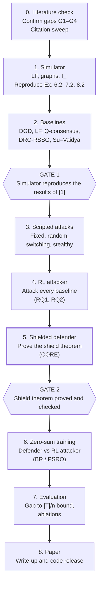

# Safe Learned Aggregation for Resilient Distributed Optimization

> **Research proposal.** A learned, adversarially trained aggregation rule for resilient distributed optimization that keeps the safety guarantees of Local Filtering (LF) by construction.

## Contents

1. [Summary](#1-summary)
2. [Background](#2-background)
3. [Related Work and Research Gap](#3-related-work-and-research-gap)
4. [Research Questions and Contributions](#4-research-questions-and-contributions)
5. [Problem Formulation](#5-problem-formulation)
6. [Workflow](#6-workflow)
7. [Experimental Design](#7-experimental-design)
8. [Risks and Open Questions](#8-risks-and-open-questions)
9. [References](#9-references)

---

## 1. Summary

We will build a learned, adversarially trained aggregation rule for resilient distributed optimization. By construction, it keeps the safety guarantees of Local Filtering (LF) [1]. We will measure how close it gets to the best accuracy any secure algorithm can reach.

The plan has three parts:

1. **RL attacker.** A reinforcement-learning (RL) attacker that finds the strongest attacks against LF-based optimization.
2. **Shielded RL defender.** An RL defender whose weights are confined to the LF-feasible set, so the consensus and safety theorems of [1] hold for every policy it can learn.
3. **Zero-sum game.** A game between the two, trained end to end and evaluated against the $\lvert T\rvert/n$ optimality lower bound of [1, Prop. 8.1].

To our knowledge, no prior work combines these. The closest learning-based defences [7], [10] address pure consensus. They either give no guarantees [7] or are evaluated only against fixed-signal attacks [10].

## 2. Background

The setting is that of Sundaram and Gharesifard [1]. It is scalar, unconstrained distributed optimization over a fixed directed graph $G = (V, E)$, in which some nodes are adversarial.

- **Goal.** Each regular node $v_i$ holds a private convex function $f_i$ with subgradients bounded by $L$. Together the regular nodes seek a minimizer of the average of their functions.
- **Adversaries.** They may know everything and coordinate. *Malicious* nodes broadcast one value to all neighbours; *Byzantine* nodes may send different values to different neighbours. The adversary set is either **F-total** (at most $F$ nodes overall) or **F-local** (at most $F$ in any regular node's in-neighbourhood).
- **Standard algorithms break.** Distributed subgradient descent [3], [4] is captured by a single node that holds its value fixed [1, Prop. 4.3]. Worse, any algorithm that is exactly optimal without adversaries can be steered anywhere by one undetectable adversary [1, Thm. 4.4].
- **LF dynamics.** Each regular node discards up to $F$ neighbour values above its own and up to $F$ below. It then takes a convex combination of the rest, with weights at least $\eta$, and a subgradient step:

$$
x_i(t+1) = a_{ii}(t)\,x_i(t) + \sum_{j \in \mathcal{J}_i(t)} a_{ij}(t)\,x_j(t) - \alpha_t\, d_i(t)
$$

**Guarantees of LF**

- Consensus for F-local Byzantine adversaries on $(2F+1)$-robust graphs [1, Thm. 6.1].
- For F-total malicious adversaries, $(F+1, F+1)$-robustness is necessary and sufficient for consensus [1, Thm. 6.4].
- With $\sum_t \alpha_t = \infty$ and $\alpha_t \to 0$, the regular nodes converge into the convex hull of their local minimizers [1, Thm. 7.1].

**What LF does not give**

- *No convergence to a single point:* one malicious node can force a permanent oscillation [1, Ex. 7.2].
- *No optimality:* any hull-respecting algorithm can be forced to an error of $\frac{\lvert T\rvert}{n}\lvert b - a\rvert$, where $T$ is a maximum F-local set [1, Prop. 8.1]. Finding $T$ is NP-hard [1, Thm. 8.4].

> [!IMPORTANT]
> **The fact this project relies on:** the theorems of [1] hold for *any* weights that form a convex combination over the retained set with every weight at least $\eta$. The weights are therefore a free design variable that can be learned without losing the guarantees.

## 3. Related Work and Research Gap

No prior work found learns the aggregation rule for resilient distributed **optimization**, keeps provable safety, and trains it against a learned multi-step attacker. Learned defences exist only for pure consensus [7], [8], [9], [10], and learned attackers only for other settings [7], [14].

### Comparison of prior work

| Ref. | Problem | Defender | Attacker | Guarantees | Optimality measured |
|---|---|---|---|---|---|
| [1] Sundaram & Gharesifard 2019 | Optimization | Fixed LF trimming | Worst-case, analytic | Consensus, convex hull | Lower bound only (Prop. 8.1) |
| [2] LeBlanc et al. 2013 | Consensus | Fixed W-MSR trimming | Worst-case, analytic | Consensus, safety | No |
| [5], [6] Su & Vaidya 2021; Zhao et al. 2020 | Optimization | Fixed filtering | Worst-case, analytic | Convergence to a region | Bounds |
| [7] Hou et al., AAAI 2021 | Consensus | RL weights (D-DDPG, Q-consensus) | Constant, random, RL faulty nodes | None | No |
| [9] Fung et al. 2022 | Consensus in MARL | RL trust selection | Unreliable agents | None | No |
| [10] Zhang, Chen, Ji, IEEE L-CSS 2026 | Consensus | Online MILP weights, Stackelberg game | Myopic best response; fixed or sinusoidal signal in simulations | Consensus, $O(\sqrt{T})$ regret (see G2) | No |
| [11], [12], [13] Resilient MARL | Multi-agent RL | Filtering protects learning | Byzantine messages | Convergence | No |
| [14] Figura et al. 2021 | Consensus-based MARL | None | Single adversarial learner | None | No |
| **This project** | **Optimization** | **RL weights inside the LF shield** | **RL, multi-step, stealthy** | **Inherited from [1]** | **Against the $\lvert T\rvert/n$ bound** |

### The gaps

| Gap | Statement | Detail |
|---|---|---|
| **G1** | No learned defence for resilient optimization. | [7] and [10] only handle consensus: no local costs and no gradient term. |
| **G2** | Learned defences lack certificates. | [7] gives no guarantee, and counts convergence to a constant faulty node as success. [10] proves safety, but its Prop. 1 case (ii) uses the non-convex combination $2x_i - x_r$, so the convex-hull argument appears not to hold. *This needs checking.* |
| **G3** | No strong learned attacker for LF/MSR-type optimization. | Existing evaluations use fixed, random or sinusoidal signals. Nobody has searched for trajectory-level attacks such as the oscillation of [1, Ex. 7.2] or the stealthy fake-cost attack of [1, Thm. 4.4]. |
| **G4** | Accuracy is never compared with what is achievable. | The $\lvert T\rvert/n$ bound of [1] has not been used as a yardstick for any learned or game-based method. |

## 4. Research Questions and Contributions

We ask four questions, one per gap.

| RQ | Gaps | Question | Contribution |
|---|---|---|---|
| **RQ1** | G3 | How much can an RL attacker degrade LF optimization (bias, oscillation, slowdown) while staying inside the bounds of [1]? | **C1.** An RL attack benchmark that recovers the attacks of [1, Ex. 7.2, Thm. 4.4] and finds stronger ones. |
| **RQ2** | G2, G3 | Do existing learned or game-based defences [7], [10] stay safe against such an attacker? | **C2.** A stress test that exposes failures of uncertified defences, or confirms their claims. |
| **RQ3** | G1, G2 | Can a defender learned inside the LF shield cut the optimality error while provably keeping consensus and safety? | **C3.** A shielded-defender theorem plus the learned aggregator itself. |
| **RQ4** | G4 | Trained in a zero-sum game, how close does the defender get to the $\lvert T\rvert/n$ lower bound? | **C4.** A game formulation, a training method, and an empirical gap to the bound across graph families. |

**C3 is the theoretical core.** It needs a short proof that every action in the shielded set meets the hypotheses of [1, Thms. 6.1, 6.4, 7.1]. Everything else is empirical.

## 5. Problem Formulation

The same simulated plant serves three learning problems. Each episode samples a graph $G$, local functions $\{f_i\}$, and an adversary set $\mathcal{A}$ (F-local or F-total). It then runs $T$ steps with $\alpha_t = c/(t+1)$.

### 5A. Attacker MDP (RQ1, RQ2)

The regular nodes run a fixed defence (LF, [7] or [10]). The adversaries act as one centralized learner, which matches the omniscient model of [1].

- **State:** $s_t = (x_R(t), x_A(t), t)$, plus the episode's graph and function parameters.
- **Action:** for malicious nodes, one value per adversary ($u_t \in \mathbb{R}^{\lvert\mathcal{A}\rvert}$); for Byzantine nodes, one value per outgoing edge of each adversary.
- **Transition:** the defence's update rule, which is deterministic.
- **Reward**, one of three:
  - *bias:* $\lvert \bar{x}_R(T) - x^\ast\rvert$, or $f(\bar{x}_R(T)) - f(x^\ast)$;
  - *non-convergence:* $\sum_t \lvert \bar{x}_R(t+1) - \bar{x}_R(t)\rvert$;
  - *stealth-penalized:* either of the above, minus a charge each time a regular node filters out the attacker's value.
- **Sanity check:** against LF, no attacker can push states outside the hull of the regular minimizers [1, Thm. 7.1]. A violation means a simulator bug.

### 5B. Shielded defender (RQ3)

Each regular node runs the same policy $\pi_\theta$ (shared parameters), executed in a decentralized way.

- **Observation** $o_i(t)$: its own state $x_i(t)$, its sorted in-neighbour values, its subgradient $d_i(t)$, the step size $\alpha_t$, and optionally a short history window.
- **Shield** (shielding in the sense of safe RL [18]): apply the LF filter first to get the retained set $\mathcal{J}_i(t)$. The policy then outputs logits over $\{i\} \cup \mathcal{J}_i(t)$. These are mapped to weights by a floored softmax, so every weight is at least $\eta$ and the weights sum to 1:

$$
a_{ij}(t) = \eta + \bigl(1 - (\lvert\mathcal{J}_i(t)\rvert + 1)\,\eta\bigr)\,\mathrm{softmax}_j\bigl(\pi_\theta(o_i(t))\bigr)
$$

- **Claim to prove (C3):** for every $\theta$, the closed loop satisfies the hypotheses of [1, Thms. 6.1, 6.4, 7.1]. So consensus and convergence into the hull hold for *any* learned policy, even one being exploited by an adversary.
- **Reward (shared):** $-\sum_i (x_i(T) - x^\ast)^2 - \lambda \sum_t D(t)$, where $D(t)$ is the gap between the largest and smallest regular state.

### 5C. Zero-sum game (RQ4)

$$
\min_{\pi_D}\ \max_{\pi_A}\ \mathbb{E}\bigl[f(\bar{x}_R(T)) - f(x^\ast)\bigr]
\quad \text{subject to: } \mathcal{A} \text{ is F-local (or F-total)}
$$

- **Training:** alternating best responses, PSRO [20], or robust multi-agent actor-critic in the style of M3DDPG [22] or RARL [21]. Optionally the attacker also chooses where the adversaries sit.
- **Yardsticks:** plain LF is the upper reference. The $\frac{\lvert T\rvert}{n}\lvert b - a\rvert$ bound of [1, Prop. 8.1] is the lower reference: no hull-respecting defender can beat it.

## 6. Workflow

The work runs in nine phases. Two gates keep us from building on unverified ground: the simulator must reproduce [1] before any learning, and the shield theorem must be proved before game training.

### Phase details

<b>Phase 0 — Literature check</b>

- Run a Google Scholar sweep of papers citing [1] and [2], filtered by learning, RL or game terms.
- Read [10] Prop. 1 in full, plus the full texts of [11] and [12].
- **Exit:** no paper covers G1–G4 together; the related-work table is final.

<b>Phase 1 — Simulator</b>

- Build a vectorized Python/NumPy environment with a Gymnasium/PettingZoo interface covering LF dynamics, Byzantine and malicious adversaries, and capped quadratic $f_i$.
- Add utilities: a robustness checker for small graphs, and a maximum F-local set solver (integer program) for computing $\lvert T\rvert$.
- **Exit:** reproduce LF consensus on the Fig. 1 graph (Ex. 6.2), the oscillation of Ex. 7.2, the $b/4$ error of Ex. 8.2, and the capture result of Prop. 4.3.

<b>Phase 2 — Baselines</b>

- Implement DGD [3], LF [1], Q-consensus [7], DRC-RSSG [10] and Su–Vaidya [5].
- Add the gradient step to [7] and [10], and state this adaptation explicitly in the paper.
- **Exit:** each baseline reproduces its own paper's headline result in its original setting.

<b>Phase 3 — Scripted attack benchmark</b>

- Implement attacks: fixed value, random, switching (Ex. 7.2), stealthy fake cost (Thm. 4.4), and "hug the trim boundary" (values just inside the retained range).
- **Deliverable:** a baseline × attack results table.

<b>Phase 4 — RL attacker (Formulation 5A)</b>

- Train with PPO or SAC against each baseline.
- **Exit:** without being told to, the attacker finds the Ex. 7.2 oscillation; it never violates Thm. 7.1 against LF; damage against [7] and [10] is reported. This also tests the [10] Prop. 1 concern empirically.

<b>Phase 5 — Shielded defender (Formulation 5B)</b>

- Write and check the shield theorem.
- Implement a DeepSets or GNN policy and train it against the scripted attacks.
- **Exit:** the proof is done; the defender beats plain LF error with zero safety violations.

<b>Phase 6 — Zero-sum training (Formulation 5C)</b>

- Train with alternating best responses or PSRO [20].
- **Exit:** the defender's exploitability falls over training iterations and it holds up against held-out attackers.

<b>Phase 7 — Evaluation</b>

- Run the full grid in [Section 7](#7-experimental-design). Report the gap to the $\lvert T\rvert/n$ bound, generalization to unseen graphs and $F$, and the ablations.

<b>Phase 8 — Paper</b>

- Write up and release the code.

## 7. Experimental Design

Every method is run against every attacker on the same graphs, functions and seeds. Results are reported as mean ± standard deviation over at least 10 seeds.

### Graphs

| Graph | Size | Purpose |
|---|---|---|
| Fig. 1 graph [1, Ex. 6.2] | 5 nodes | Not rooted after filtering; tests the $(F+1, F+1)$ proof. |
| Complete graph [1, Ex. 7.2] | 5 nodes | Reproduces the oscillation attack. |
| U-W graph [1, Fig. 3, Ex. 8.2] | $4K$ nodes ($K \ge 2$) | Large maximum 1-local set; error must reach $b/4$. |
| Random $(2F+1)$-robust graphs (constructions in [2], [16]) | 20–100 nodes | Main benchmark. |
| Erdős–Rényi above the threshold of [1, Sec. VIII] | 20–100 nodes | Small $\lvert T\rvert/n$; checks that the bound fades. |

### Functions

Capped quadratics $f_i(x) = (x - a_i)^2$ with $a_i$ drawn per episode, plus the two-cluster $a/b$ assignment of [1, Prop. 8.1] for the lower-bound tests. Absolute-value functions are added as a non-smooth check.

### Attackers

Fixed value; random; switching (Ex. 7.2); stealthy fake cost (Thm. 4.4); trim-boundary hugging; learned RL attacker (Formulation 5A). Each is run in malicious and Byzantine variants, with $F \in \{1, 2, 3\}$.

### Methods compared

| # | Method | Source | Role |
|---|---|---|---|
| 1 | Distributed subgradient descent | Nedić & Ozdaglar [3], [4] | No defence: shows the size of the threat |
| 2 | LF dynamics | Sundaram & Gharesifard [1] | Main baseline; our method builds on it |
| 3 | Byzantine-resilient optimization | Su & Vaidya [5] | Classical filtering baseline |
| 4 | Q-consensus + gradient step | Hou et al. [7] | Prior RL defence (adapted) |
| 5 | DRC-RSSG + gradient step | Zhang, Chen, Ji [10] | Newest game-based defence (adapted) |
| 6 | **Shielded RL defender** | This work | Proposed (Formulation 5B) |
| 7 | **Shielded RL defender, game-trained** | This work | Proposed (Formulation 5C) |

### Metrics

- **Optimality error:** $\lvert \bar{x}_R(T) - x^\ast\rvert$ and $f(\bar{x}_R(T)) - f(x^\ast)$, also as a fraction of the $\frac{\lvert T\rvert}{n}\lvert b - a\rvert$ bound.
- **Consensus:** $D(T) = M(T) - m(T)$, and the number of steps until $D(t) < \epsilon$.
- **Safety:** the share of runs in which any regular state leaves the hull of the regular minimizers. This must be 0 for methods 2, 6 and 7.
- **Oscillation:** total variation of $\bar{x}_R(t)$ over the second half of the run.
- **Exploitability** of the defenders: the damage done by a best-response RL attacker trained against that defender.

### Ablations

- No shield (raw RL weights)
- Shield without adversarial training
- Observation with or without history
- DeepSets vs GNN policy
- Training $F$ vs test $F$ mismatch

## 8. Risks and Open Questions

### Risks

| Risk | Why it matters | Fallback |
|---|---|---|
| The shield leaves too little freedom: learned weights barely beat uniform LF. | Weakens C3 and C4. | Let the policy also choose the trim level within $[F, F_{\max}]$, and prove a matching weaker guarantee; or report the honest null result, which still answers RQ3. |
| The $\lvert T\rvert/n$ bound is loose, so the gap to it looks large even for a near-optimal defender. | Makes C4 hard to read. | Also compute the best achievable error for small graphs by exhaustive search over adversary placements. |
| Zero-sum training is unstable. | Delays Phase 6. | Use PSRO with a fixed population; fall back to a defender trained against the Phase 4 attacker only. |
| The [10] Prop. 1 concern turns out to be our misreading. | Weakens G2. | Keep G2 on [7] alone; frame [10] as complementary (no-regret, edge-based model). |
| A competing paper appears during the project. | Novelty. | Phase 0 sweep, repeated before submission. |

### Open questions

- Scalar only, as in [1], or a coordinate-wise multidimensional extension as a second paper? The plan assumes scalar.
- Should the attacker also choose where the adversaries sit (topology-aware placement), or only what they send?
- Timeline and target venue: to be agreed before Phase 1 starts.

## 9. References

- **[1]** S. Sundaram and B. Gharesifard, "Distributed optimization under adversarial nodes," *IEEE Trans. Autom. Control*, vol. 64, no. 3, pp. 1063–1076, Mar. 2019. https://doi.org/10.1109/TAC.2018.2836919
- **[2]** H. J. LeBlanc, H. Zhang, X. Koutsoukos, and S. Sundaram, "Resilient asymptotic consensus in robust networks," *IEEE J. Sel. Areas Commun.*, vol. 31, no. 4, pp. 766–781, Apr. 2013. https://doi.org/10.1109/JSAC.2013.130413
- **[3]** A. Nedić and A. Ozdaglar, "Distributed subgradient methods for multi-agent optimization," *IEEE Trans. Autom. Control*, vol. 54, no. 1, pp. 48–61, Jan. 2009.
- **[4]** A. Nedić, A. Ozdaglar, and P. A. Parrilo, "Constrained consensus and optimization in multi-agent networks," *IEEE Trans. Autom. Control*, vol. 55, no. 4, pp. 922–938, Apr. 2010.
- **[5]** L. Su and N. H. Vaidya, "Byzantine-resilient multiagent optimization," *IEEE Trans. Autom. Control*, vol. 66, no. 5, pp. 2227–2233, May 2021.
- **[6]** C. Zhao, J. He, and Q.-G. Wang, "Resilient distributed optimization algorithm against adversarial attacks," *IEEE Trans. Autom. Control*, vol. 65, no. 10, pp. 4308–4315, Oct. 2020.
- **[7]** J. Hou, F. Wang, L. Wang, and Z. Chen, "Reinforcement learning based multi-agent resilient control: From deep neural networks to an adaptive law," in *Proc. AAAI Conf. Artif. Intell.*, vol. 35, no. 9, pp. 7737–7745, 2021. https://ojs.aaai.org/index.php/AAAI/article/view/16945
- **[8]** J. Hou, Z. Chen, Z. Lin, and M. Xiang, "Resilient consensus via weight learning and its application in fault-tolerant clock synchronization," arXiv:2002.03541, 2020. https://arxiv.org/abs/2002.03541
- **[9]** H. L. Fung, V.-A. Darvariu, S. Hailes, and M. Musolesi, "Trust-based consensus in multi-agent reinforcement learning systems," arXiv:2205.12880, 2022. https://arxiv.org/abs/2205.12880
- **[10]** S. Zhang, G. Chen, and Y. Ji, "Distributed resilient consensus of multi-agent systems against adaptive adversaries via repeated Stackelberg security games," *IEEE Control Syst. Lett.*, vol. 10, pp. 1861–1866, 2026. https://doi.org/10.1109/LCSYS.2026.3709160
- **[11]** H. Lee and D. Panagou, "Fully Byzantine-resilient multi-agent reinforcement learning," arXiv:2609.25701, Sep. 2026. https://arxiv.org/abs/2609.25701
- **[12]** Y. Jiang, J. Pan, M. Li, and L. Jin, "Secure multi-agent reinforcement learning for service systems with affinity and Byzantine nodes: Stability analysis and protection design," accepted at ICML 2026 (details from the SJTU announcement; verify). https://gc.sjtu.edu.cn/off-the-press/2026-05-21/161822/
- **[13]** "Resilient consensus-based multi-agent reinforcement learning with function approximation," arXiv:2111.06776, 2021 (authors to be filled in). https://arxiv.org/abs/2111.06776
- **[14]** M. Figura, K. C. Kosaraju, and V. Gupta, "Adversarial attacks in consensus-based multi-agent reinforcement learning," arXiv:2103.06967, 2021. https://arxiv.org/abs/2103.06967
- **[15]** N. H. Vaidya, L. Tseng, and G. Liang, "Iterative approximate Byzantine consensus in arbitrary directed graphs," in *Proc. ACM PODC*, 2012, pp. 365–374.
- **[16]** H. Zhang, E. Fata, and S. Sundaram, "A notion of robustness in complex networks," *IEEE Trans. Control Netw. Syst.*, vol. 2, no. 3, pp. 310–320, Sep. 2015.
- **[17]** H. Ishii, Y. Wang, and S. Feng, "An overview on multi-agent consensus under adversarial attacks," *Annu. Rev. Control*, vol. 53, pp. 252–272, 2022.
- **[18]** M. Alshiekh, R. Bloem, R. Ehlers, B. Könighofer, S. Niekum, and U. Topcu, "Safe reinforcement learning via shielding," in *Proc. AAAI*, 2018. https://arxiv.org/abs/1708.08611
- **[19]** R. Lowe, Y. Wu, A. Tamar, J. Harb, P. Abbeel, and I. Mordatch, "Multi-agent actor-critic for mixed cooperative-competitive environments," in *Proc. NeurIPS*, 2017.
- **[20]** M. Lanctot et al., "A unified game-theoretic approach to multiagent reinforcement learning," in *Proc. NeurIPS*, 2017.
- **[21]** L. Pinto, J. Davidson, R. Sukthankar, and A. Gupta, "Robust adversarial reinforcement learning," in *Proc. ICML*, 2017.
- **[22]** S. Li, Y. Wu, X. Cui, H. Dong, F. Fang, and S. Russell, "Robust multi-agent reinforcement learning via minimax deep deterministic policy gradient," in *Proc. AAAI*, 2019.
- **[23]** "A survey on secure decentralized optimization and learning," arXiv:2408.08628, 2024 (authors to be filled in). https://arxiv.org/abs/2408.08628

*Background surveys for related-work writing: [15], [17], [23]. Multi-agent RL tooling: [19].*
