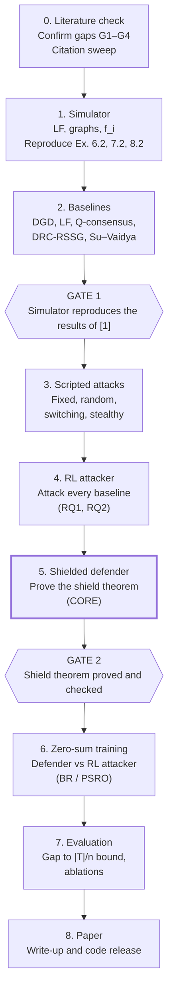

# Safe Learned Aggregation for Resilient Distributed Optimization

> **Research proposal.** We want a learned, adversarially trained aggregation rule for resilient distributed optimization that keeps the safety guarantees of Local Filtering (LF) by construction.

> **Where we are:** Phases 1–7 are implemented. The learned attacker and the safety shield work as planned, but the learned defender does not yet beat LF on accuracy. [IMPLEMENTATION.md](IMPLEMENTATION.md) has the full results, what we learned, and the next steps.

## Contents

1. [Summary](#1-summary)
2. [Background](#2-background)
3. [Related Work and Research Gap](#3-related-work-and-research-gap)
4. [Research Questions and Contributions](#4-research-questions-and-contributions)
5. [Problem Formulation](#5-problem-formulation)
6. [Workflow](#6-workflow)
7. [Experimental Design](#7-experimental-design)
8. [Risks and Open Questions](#8-risks-and-open-questions)
9. [References](#9-references)

---

## 1. Summary

When some agents in a network lie, the standard way to stay safe is Local Filtering (LF) [1]. Each agent throws away the most extreme values it receives and averages the rest. LF comes with strong guarantees, but it is not optimal, and nobody knows how much accuracy it gives up against a really smart attacker. This project uses reinforcement learning (RL) on both sides of that question.

The plan has three parts, and each one builds on the one before:

1. **RL attacker.** We first train an attacker to find the strongest possible attacks on LF-based optimization. This tells us how much damage is actually possible.
2. **Shielded RL defender.** We then train a defender that learns its own averaging weights. Its weights are always confined to the set that LF allows, so the consensus and safety theorems of [1] hold for every policy it could ever learn.
3. **Zero-sum game.** Finally, we let the attacker and the defender train against each other, and we measure the result against the best accuracy any safe algorithm can reach, the $\lvert T\rvert/n$ lower bound of [1, Prop. 8.1].

As far as we know, no prior work combines these three parts. The closest learning-based defences [7], [10] only handle pure consensus, and they either come with no guarantees [7] or are tested only against fixed-signal attacks [10].

## 2. Background

We work in the setting of Sundaram and Gharesifard [1]: scalar, unconstrained distributed optimization over a fixed directed graph $G = (V, E)$ in which some nodes are adversarial.

Each regular node $v_i$ holds a private convex function $f_i$ whose subgradients are bounded by $L$, and the regular nodes together want to minimize the average of their functions. The adversaries may know everything and may coordinate. *Malicious* nodes send the same value to all their neighbours, while *Byzantine* nodes may send different values to different neighbours. We bound their number in one of two ways: **F-total** means at most $F$ adversaries in the whole network, and **F-local** means at most $F$ among the in-neighbours of any regular node.

Standard algorithms break easily in this setting. In distributed subgradient descent [3], [4], a single node that keeps its value fixed can drag everyone to it [1, Prop. 4.3]. It gets worse: any algorithm that is exactly optimal without adversaries can be steered anywhere by one adversary that nobody can detect [1, Thm. 4.4].

LF avoids this. Each regular node discards up to $F$ neighbour values above its own and up to $F$ below. It then takes a convex combination of what is left, with every weight at least $\eta$, and adds a subgradient step:

$$
x_i(t+1) = a_{ii}(t)\,x_i(t) + \sum_{j \in \mathcal{J}_i(t)} a_{ij}(t)\,x_j(t) - \alpha_t\, d_i(t)
$$

**What LF guarantees.** On $(2F+1)$-robust graphs, the regular nodes reach consensus even against F-local Byzantine adversaries [1, Thm. 6.1]. For F-total malicious adversaries, $(F+1, F+1)$-robustness is both necessary and sufficient for consensus [1, Thm. 6.4]. If the step sizes satisfy $\sum_t \alpha_t = \infty$ and $\alpha_t \to 0$, the regular nodes also end up inside the convex hull of their local minimizers [1, Thm. 7.1].

**What LF does not guarantee.** The nodes need not settle on a single point: one malicious node can keep them oscillating forever [1, Ex. 7.2]. LF is also not optimal. In fact, any algorithm that respects the hull can be forced to an error of $\frac{\lvert T\rvert}{n}\lvert b - a\rvert$, where $T$ is a maximum F-local set [1, Prop. 8.1], and finding $T$ is NP-hard [1, Thm. 8.4].

> [!IMPORTANT]
> **The fact this project relies on:** the theorems of [1] hold for *any* weights that form a convex combination over the retained set with every weight at least $\eta$. The weights are therefore a free design variable, and we can learn them without losing the guarantees.

## 3. Related Work and Research Gap

We found no prior work that learns the aggregation rule for resilient distributed **optimization**, keeps provable safety, and trains it against a learned multi-step attacker. Learned defences exist, but only for pure consensus [7], [8], [9], [10], and learned attackers have only been studied in other settings [7], [14]. The table below compares the closest work.

### Comparison of prior work

| Ref. | Problem | Defender | Attacker | Guarantees | Optimality measured |
|---|---|---|---|---|---|
| [1] Sundaram & Gharesifard 2019 | Optimization | Fixed LF trimming | Worst-case, analytic | Consensus, convex hull | Lower bound only (Prop. 8.1) |
| [2] LeBlanc et al. 2013 | Consensus | Fixed W-MSR trimming | Worst-case, analytic | Consensus, safety | No |
| [5], [6] Su & Vaidya 2021; Zhao et al. 2020 | Optimization | Fixed filtering | Worst-case, analytic | Convergence to a region | Bounds |
| [7] Hou et al., AAAI 2021 | Consensus | RL weights (D-DDPG, Q-consensus) | Constant, random, RL faulty nodes | None | No |
| [9] Fung et al. 2022 | Consensus in MARL | RL trust selection | Unreliable agents | None | No |
| [10] Zhang, Chen, Ji, IEEE L-CSS 2026 | Consensus | Online MILP weights, Stackelberg game | Myopic best response; fixed or sinusoidal signal in simulations | Consensus, $O(\sqrt{T})$ regret (see G2) | No |
| [11], [12], [13] Resilient MARL | Multi-agent RL | Filtering protects learning | Byzantine messages | Convergence | No |
| [14] Figura et al. 2021 | Consensus-based MARL | None | Single adversarial learner | None | No |
| **This project** | **Optimization** | **RL weights inside the LF shield** | **RL, multi-step, stealthy** | **Inherited from [1]** | **Against the $\lvert T\rvert/n$ bound** |

### The gaps

Reading the table row by row, four gaps stand out.

| Gap | Statement | Detail |
|---|---|---|
| **G1** | No learned defence for resilient optimization. | [7] and [10] only handle consensus, so they have no local costs and no gradient term. |
| **G2** | Learned defences lack certificates. | [7] gives no guarantee, and even counts convergence to a constant faulty node as success. [10] does prove safety, but its Prop. 1 case (ii) uses the non-convex combination $2x_i - x_r$, so the convex-hull argument seems not to hold. *(Our Phase 2 confirmed this with a counterexample; see IMPLEMENTATION.md.)* |
| **G3** | No strong learned attacker for LF/MSR-type optimization. | Existing evaluations use fixed, random or sinusoidal signals. Nobody has searched for attacks that play out over a whole trajectory, such as the oscillation of [1, Ex. 7.2] or the stealthy fake-cost attack of [1, Thm. 4.4]. |
| **G4** | Accuracy is never compared with what is achievable. | No learned or game-based method has been measured against the $\lvert T\rvert/n$ bound of [1]. |

## 4. Research Questions and Contributions

Each gap leads to one research question, and each question to one contribution.

| RQ | Gaps | Question | Contribution |
|---|---|---|---|
| **RQ1** | G3 | How much can an RL attacker degrade LF optimization (bias, oscillation, slowdown) while staying inside the bounds of [1]? | **C1.** An RL attack benchmark that recovers the attacks of [1, Ex. 7.2, Thm. 4.4] and finds stronger ones. |
| **RQ2** | G2, G3 | Do existing learned or game-based defences [7], [10] stay safe against such an attacker? | **C2.** A stress test that exposes failures of uncertified defences, or confirms their claims. |
| **RQ3** | G1, G2 | Can a defender learned inside the LF shield cut the optimality error while provably keeping consensus and safety? | **C3.** A shielded-defender theorem plus the learned aggregator itself. |
| **RQ4** | G4 | Trained in a zero-sum game, how close does the defender get to the $\lvert T\rvert/n$ lower bound? | **C4.** A game formulation, a training method, and an empirical gap to the bound across graph families. |

**C3 is the theoretical core.** It needs a short proof that every action in the shielded set meets the hypotheses of [1, Thms. 6.1, 6.4, 7.1]; everything else is empirical. The proof is now written up in [docs/shield_theorem.md](docs/shield_theorem.md).

## 5. Problem Formulation

All three learning problems share the same simulated network. Each episode draws a graph $G$, local functions $\{f_i\}$ and an adversary set $\mathcal{A}$ (F-local or F-total), and then runs $T$ steps with a decreasing step size $\alpha_t$.

### 5A. Attacker MDP (RQ1, RQ2)

Here the regular nodes run a fixed defence (LF, [7] or [10]), and the adversaries act as one central learner, which matches the all-knowing adversary of [1].

- **State:** $s_t = (x_R(t), x_A(t), t)$, together with the episode's graph and function parameters.
- **Action:** malicious nodes choose one value each ($u_t \in \mathbb{R}^{\lvert\mathcal{A}\rvert}$); Byzantine nodes choose one value per outgoing edge.
- **Transition:** the defence's own update rule, which is deterministic.
- **Reward:** one of three, depending on what the attacker should achieve:
  - *bias:* $\lvert \bar{x}_R(T) - x^\ast\rvert$, or $f(\bar{x}_R(T)) - f(x^\ast)$;
  - *non-convergence:* $\sum_t \lvert \bar{x}_R(t+1) - \bar{x}_R(t)\rvert$;
  - *stealth-penalized:* either of the above, minus a charge every time a regular node filters out the attacker's value.
- **Sanity check:** against LF, no attacker should be able to push states outside the hull of the regular minimizers [1, Thm. 7.1]. If one does, the simulator has a bug.

### 5B. Shielded defender (RQ3)

Every regular node runs the same policy $\pi_\theta$ with shared parameters, but each node acts only on what it sees locally.

- **Observation** $o_i(t)$: its own state $x_i(t)$, its sorted in-neighbour values, its subgradient $d_i(t)$, the step size $\alpha_t$, and optionally a short history.
- **Shield** (in the sense of safe RL [18]): the node first applies the LF filter to get the retained set $\mathcal{J}_i(t)$. The policy then scores itself and each retained neighbour, and a floored softmax turns the scores into weights that are each at least $\eta$ and sum to 1:

$$
a_{ij}(t) = \eta + \bigl(1 - (\lvert\mathcal{J}_i(t)\rvert + 1)\,\eta\bigr)\,\mathrm{softmax}_j\bigl(\pi_\theta(o_i(t))\bigr)
$$

- **Claim to prove (C3):** for every $\theta$, the closed loop satisfies the hypotheses of [1, Thms. 6.1, 6.4, 7.1]. Consensus and convergence into the hull therefore hold for *any* learned policy, even one that an adversary is actively exploiting.
- **Reward (shared):** $-\sum_i (x_i(T) - x^\ast)^2 - \lambda \sum_t D(t)$, where $D(t)$ is the gap between the largest and smallest regular state.

### 5C. Zero-sum game (RQ4)

Putting the two together gives a game in which the defender minimizes the error that the strongest attacker can cause:

$$
\min_{\pi_D}\ \max_{\pi_A}\ \mathbb{E}\bigl[f(\bar{x}_R(T)) - f(x^\ast)\bigr]
\quad \text{subject to: } \mathcal{A} \text{ is F-local (or F-total)}
$$

- **Training:** alternating best responses, PSRO [20], or a robust multi-agent actor-critic in the style of M3DDPG [22] or RARL [21]. The attacker could also choose where the adversaries sit.
- **Yardsticks:** plain LF is the reference we want to beat. The $\frac{\lvert T\rvert}{n}\lvert b - a\rvert$ bound of [1, Prop. 8.1] is the floor that no hull-respecting defender can go below.

## 6. Workflow

The work runs in nine phases. Two gates stop us from building on unverified ground: the simulator must reproduce [1] before any learning starts, and the shield theorem must be proved before game training.

### Phase details

<b>Phase 0 — Literature check</b>

We sweep Google Scholar for papers that cite [1] and [2] and mention learning, RL or games. We also read [10] Prop. 1 in full, along with the full texts of [11] and [12]. The phase is done once we are sure no paper covers G1–G4 together and the related-work table is final.

<b>Phase 1 — Simulator</b>

We build a vectorized Python/NumPy simulator of the LF dynamics with Byzantine and malicious adversaries and capped quadratic $f_i$. Alongside it we add a robustness checker for small graphs and an integer-program solver for the maximum F-local set, which gives us $\lvert T\rvert$. The simulator passes this phase once it reproduces LF consensus on the Fig. 1 graph (Ex. 6.2), the oscillation of Ex. 7.2, the $b/4$ error of Ex. 8.2 and the capture result of Prop. 4.3.

<b>Phase 2 — Baselines</b>

We implement DGD [3], LF [1], Q-consensus [7], DRC-RSSG [10] and Su–Vaidya [5]. Since [7] and [10] were designed for consensus, we add the gradient step to them and say so explicitly in the paper. Each baseline should reproduce its own paper's headline result in its original setting.

<b>Phase 3 — Scripted attack benchmark</b>

Before any learning, we see how far hand design gets us. We implement a fixed-value attack, a random one, the switching attack of Ex. 7.2, the stealthy fake-cost attack of Thm. 4.4, and a "hug the trim boundary" attack that sends values just inside the range LF keeps. The result is a table of every baseline against every attack.

<b>Phase 4 — RL attacker (Formulation 5A)</b>

We then train an attacker with PPO or SAC against each baseline. We hope it finds the Ex. 7.2 oscillation without being told to. It must never violate Thm. 7.1 against LF, and we report how much damage it does to [7] and [10], which also tests the Prop. 1 concern about [10] in practice.

<b>Phase 5 — Shielded defender (Formulation 5B)</b>

This is the core phase. We write and check the shield theorem, and then train a DeepSets or GNN policy against the scripted attacks. The goal is a finished proof and a defender that beats plain LF's error with zero safety violations.

<b>Phase 6 — Zero-sum training (Formulation 5C)</b>

We let the defender and attacker adapt to each other through alternating best responses or PSRO [20]. If this works, the defender's exploitability should fall over training, and the defender should hold up against attackers it has never seen.

<b>Phase 7 — Evaluation</b>

We run the full grid of [Section 7](#7-experimental-design) and report the gap to the $\lvert T\rvert/n$ bound, how well the methods generalize to unseen graphs and values of $F$, and the ablations.

<b>Phase 8 — Paper</b>

We write up the results and release the code.

## 7. Experimental Design

To keep the comparison fair, every method faces every attacker on the same graphs, functions and seeds, and we report mean ± standard deviation over at least 10 seeds.

### Graphs

We use the small example graphs of [1] to check specific claims, and larger random graphs as the main benchmark.

| Graph | Size | Purpose |
|---|---|---|
| Fig. 1 graph [1, Ex. 6.2] | 5 nodes | Not rooted after filtering; tests the $(F+1, F+1)$ proof. |
| Complete graph [1, Ex. 7.2] | 5 nodes | Reproduces the oscillation attack. |
| U-W graph [1, Fig. 3, Ex. 8.2] | $4K$ nodes ($K \ge 2$) | Large maximum 1-local set; error must reach $b/4$. |
| Random $(2F+1)$-robust graphs (constructions in [2], [16]) | 20–100 nodes | Main benchmark. |
| Erdős–Rényi above the threshold of [1, Sec. VIII] | 20–100 nodes | Small $\lvert T\rvert/n$; checks that the bound fades. |

### Functions

The local functions are capped quadratics $f_i(x) = (x - a_i)^2$, with $a_i$ drawn per episode. For the lower-bound tests we use the two-cluster $a/b$ assignment of [1, Prop. 8.1], and we add absolute-value functions as a non-smooth check.

### Attackers

We use six attackers: a fixed value, a random one, switching (Ex. 7.2), stealthy fake cost (Thm. 4.4), trim-boundary hugging, and the learned RL attacker (Formulation 5A). Each runs in a malicious and a Byzantine version, with $F \in \{1, 2, 3\}$.

### Methods compared

| # | Method | Source | Role |
|---|---|---|---|
| 1 | Distributed subgradient descent | Nedić & Ozdaglar [3], [4] | No defence: shows the size of the threat |
| 2 | LF dynamics | Sundaram & Gharesifard [1] | Main baseline; our method builds on it |
| 3 | Byzantine-resilient optimization | Su & Vaidya [5] | Classical filtering baseline |
| 4 | Q-consensus + gradient step | Hou et al. [7] | Prior RL defence (adapted) |
| 5 | DRC-RSSG + gradient step | Zhang, Chen, Ji [10] | Newest game-based defence (adapted) |
| 6 | **Shielded RL defender** | This work | Proposed (Formulation 5B) |
| 7 | **Shielded RL defender, game-trained** | This work | Proposed (Formulation 5C) |

### Metrics

We measure five things, covering accuracy, agreement, safety and robustness:

- **Optimality error:** $\lvert \bar{x}_R(T) - x^\ast\rvert$ and $f(\bar{x}_R(T)) - f(x^\ast)$, also as a fraction of the $\frac{\lvert T\rvert}{n}\lvert b - a\rvert$ bound.
- **Consensus:** the final spread $D(T) = M(T) - m(T)$, and the number of steps until $D(t) < \epsilon$.
- **Safety:** the share of runs in which any regular state leaves the hull of the regular minimizers. For methods 2, 6 and 7 this must be 0.
- **Oscillation:** the total variation of $\bar{x}_R(t)$ over the second half of the run.
- **Exploitability** of a defender: the damage done by an RL attacker trained specifically against it.

### Ablations

To see which parts of the design matter, we remove them one at a time:

- no shield (raw RL weights);
- the shield without adversarial training;
- observations with or without history;
- a DeepSets vs a GNN policy;
- training on one $F$ and testing on another.

## 8. Risks and Open Questions

### Risks

| Risk | Why it matters | Fallback |
|---|---|---|
| The shield leaves too little freedom, so learned weights barely beat uniform LF. *(This is what we see so far; see IMPLEMENTATION.md, Phases 5–7.)* | Weakens C3 and C4. | Let the policy also choose the trim level within $[F, F_{\max}]$ and prove a matching weaker guarantee, or report the honest null result, which still answers RQ3. |
| The $\lvert T\rvert/n$ bound is loose, so even a near-optimal defender looks far from it. | Makes C4 hard to read. | Also compute the best achievable error on small graphs by exhaustive search over adversary placements. |
| Zero-sum training is unstable. | Delays Phase 6. | Use PSRO with a fixed population, or fall back to a defender trained only against the Phase 4 attacker. |
| The [10] Prop. 1 concern turns out to be our misreading. *(Our counterexample suggests it is not.)* | Weakens G2. | Keep G2 on [7] alone and present [10] as complementary (no-regret, edge-based model). |
| A competing paper appears during the project. | Novelty. | Repeat the Phase 0 sweep before submission. |

### Open questions

- Should we stay scalar, as in [1], or save a coordinate-wise multidimensional extension for a second paper? The plan assumes scalar.
- Should the attacker also choose where the adversaries sit, or only what they send?
- What is the timeline and the target venue?

## 9. References

- **[1]** S. Sundaram and B. Gharesifard, "Distributed optimization under adversarial nodes," *IEEE Trans. Autom. Control*, vol. 64, no. 3, pp. 1063–1076, Mar. 2019. https://doi.org/10.1109/TAC.2018.2836919
- **[2]** H. J. LeBlanc, H. Zhang, X. Koutsoukos, and S. Sundaram, "Resilient asymptotic consensus in robust networks," *IEEE J. Sel. Areas Commun.*, vol. 31, no. 4, pp. 766–781, Apr. 2013. https://doi.org/10.1109/JSAC.2013.130413
- **[3]** A. Nedić and A. Ozdaglar, "Distributed subgradient methods for multi-agent optimization," *IEEE Trans. Autom. Control*, vol. 54, no. 1, pp. 48–61, Jan. 2009.
- **[4]** A. Nedić, A. Ozdaglar, and P. A. Parrilo, "Constrained consensus and optimization in multi-agent networks," *IEEE Trans. Autom. Control*, vol. 55, no. 4, pp. 922–938, Apr. 2010.
- **[5]** L. Su and N. H. Vaidya, "Byzantine-resilient multiagent optimization," *IEEE Trans. Autom. Control*, vol. 66, no. 5, pp. 2227–2233, May 2021.
- **[6]** C. Zhao, J. He, and Q.-G. Wang, "Resilient distributed optimization algorithm against adversarial attacks," *IEEE Trans. Autom. Control*, vol. 65, no. 10, pp. 4308–4315, Oct. 2020.
- **[7]** J. Hou, F. Wang, L. Wang, and Z. Chen, "Reinforcement learning based multi-agent resilient control: From deep neural networks to an adaptive law," in *Proc. AAAI Conf. Artif. Intell.*, vol. 35, no. 9, pp. 7737–7745, 2021. https://ojs.aaai.org/index.php/AAAI/article/view/16945
- **[8]** J. Hou, Z. Chen, Z. Lin, and M. Xiang, "Resilient consensus via weight learning and its application in fault-tolerant clock synchronization," arXiv:2002.03541, 2020. https://arxiv.org/abs/2002.03541
- **[9]** H. L. Fung, V.-A. Darvariu, S. Hailes, and M. Musolesi, "Trust-based consensus in multi-agent reinforcement learning systems," arXiv:2205.12880, 2022. https://arxiv.org/abs/2205.12880
- **[10]** S. Zhang, G. Chen, and Y. Ji, "Distributed resilient consensus of multi-agent systems against adaptive adversaries via repeated Stackelberg security games," *IEEE Control Syst. Lett.*, vol. 10, pp. 1861–1866, 2026. https://doi.org/10.1109/LCSYS.2026.3709160
- **[11]** H. Lee and D. Panagou, "Fully Byzantine-resilient multi-agent reinforcement learning," arXiv:2609.25701, Sep. 2026. https://arxiv.org/abs/2609.25701
- **[12]** Y. Jiang, J. Pan, M. Li, and L. Jin, "Secure multi-agent reinforcement learning for service systems with affinity and Byzantine nodes: Stability analysis and protection design," accepted at ICML 2026 (details from the SJTU announcement; verify). https://gc.sjtu.edu.cn/off-the-press/2026-05-21/161822/
- **[13]** "Resilient consensus-based multi-agent reinforcement learning with function approximation," arXiv:2111.06776, 2021 (authors to be filled in). https://arxiv.org/abs/2111.06776
- **[14]** M. Figura, K. C. Kosaraju, and V. Gupta, "Adversarial attacks in consensus-based multi-agent reinforcement learning," arXiv:2103.06967, 2021. https://arxiv.org/abs/2103.06967
- **[15]** N. H. Vaidya, L. Tseng, and G. Liang, "Iterative approximate Byzantine consensus in arbitrary directed graphs," in *Proc. ACM PODC*, 2012, pp. 365–374.
- **[16]** H. Zhang, E. Fata, and S. Sundaram, "A notion of robustness in complex networks," *IEEE Trans. Control Netw. Syst.*, vol. 2, no. 3, pp. 310–320, Sep. 2015.
- **[17]** H. Ishii, Y. Wang, and S. Feng, "An overview on multi-agent consensus under adversarial attacks," *Annu. Rev. Control*, vol. 53, pp. 252–272, 2022.
- **[18]** M. Alshiekh, R. Bloem, R. Ehlers, B. Könighofer, S. Niekum, and U. Topcu, "Safe reinforcement learning via shielding," in *Proc. AAAI*, 2018. https://arxiv.org/abs/1708.08611
- **[19]** R. Lowe, Y. Wu, A. Tamar, J. Harb, P. Abbeel, and I. Mordatch, "Multi-agent actor-critic for mixed cooperative-competitive environments," in *Proc. NeurIPS*, 2017.
- **[20]** M. Lanctot et al., "A unified game-theoretic approach to multiagent reinforcement learning," in *Proc. NeurIPS*, 2017.
- **[21]** L. Pinto, J. Davidson, R. Sukthankar, and A. Gupta, "Robust adversarial reinforcement learning," in *Proc. ICML*, 2017.
- **[22]** S. Li, Y. Wu, X. Cui, H. Dong, F. Fang, and S. Russell, "Robust multi-agent reinforcement learning via minimax deep deterministic policy gradient," in *Proc. AAAI*, 2019.
- **[23]** "A survey on secure decentralized optimization and learning," arXiv:2408.08628, 2024 (authors to be filled in). https://arxiv.org/abs/2408.08628

Background surveys for the related-work section are [15], [17] and [23]; [19] covers multi-agent RL tooling.
